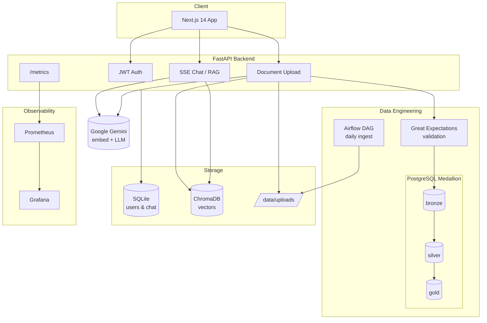

# RAG Chatbot — Production + Data Engineering

[](https://github.com/YOUR_USERNAME/rag-chatbot/actions/workflows/ci.yml)
[](https://render.com/deploy)

> Chatbot hỏi đáp tài liệu (RAG) với **Google Gemini**, JWT multi-user, **Medallion warehouse**, **Airflow**, **Great Expectations**, **Prometheus/Grafana**.

---

## Live Demo

| | URL |
|---|-----|
| **App (UI)** | `https://rag-web.onrender.com` ← thay sau khi deploy |
| **API** | `https://rag-api.onrender.com` |
| **Health** | `https://rag-api.onrender.com/health` |
| **Swagger** | `https://rag-api.onrender.com/docs` |

> **Free tier:** service sleep sau ~15 phút không dùng — lần mở đầu có thể chờ 30–60s.

### Demo nhanh cho recruiter

1. Mở link App → **Đăng ký** tài khoản  
2. **Tài liệu** → upload file PDF/DOCX/TXT mẫu  
3. **Hỏi về tài liệu** → đặt câu hỏi theo nội dung file  
4. *(Admin)* user đăng ký **đầu tiên** = role `admin` → tab **Admin**

<!-- Thêm GIF sau khi quay màn hình (15–30s): -->
<!--  -->

---

## Architecture



### Medallion pipeline

```
uploads/{user_id}/file.pdf
    → Bronze   raw_documents (metadata + hash)
    → GE       document_chunks_suite validation
    → Silver   document_chunks (cleaned)
    → Gold     document_summary, daily_ingest_stats
    → ChromaDB embedding index (RAG retrieval)
```

---

## Roadmap tuần 1–4 (đã triển khai)

| Tuần | Tính năng | Chi tiết |
|------|-----------|----------|
| 1–2 | **Redis cache** | Cache kết quả retrieve theo `user_id` + hash câu hỏi (`REDIS_URL`, TTL mặc định 300s). Docker Compose có service `redis`. |
| 1–2 | **Cohere Rerank** | Lấy `RETRIEVE_CANDIDATES` chunk (mặc định 15), rerank về `TOP_K` — bật bằng `COHERE_API_KEY`. |
| 3–4 | **OCR ảnh** | Upload PNG/JPG/WebP/GIF → Gemini Vision trích chữ → chunk + embed như TXT. |
| 3–4 | **Auto-suggest** | `GET /documents/suggested-questions` + chip gợi ý trên màn chat. |
| 5–6 | **Analytics** | `GET /analytics/overview`, `/analytics/daily` + trang `/analytics`. |
| 5–6 | **Embed widget** | `POST /embed/tokens`, `GET /embed/widget.js`, iframe `/embed?token=…`. |
| 7–8 | **Stripe** | `POST /billing/checkout`, `/billing/webhook`, gói Free/Pro + hạn mức/ngày. |
| 7–8 | **Public API** | `POST /api-keys`, `POST /v1/ask` (header `X-API-Key`). |

## Tech stack

| Layer | Stack |
|-------|--------|
| Frontend | Next.js 14, Tailwind, shadcn/ui |
| API | FastAPI, LangChain, ChromaDB |
| LLM / Embed | Gemini 2.5 Flash, gemini-embedding-001 |
| App DB | SQLite |
| Warehouse | PostgreSQL (bronze / silver / gold) |
| Orchestration | Apache Airflow |
| Data quality | Great Expectations (suite + checkpoint) |
| Monitoring | Prometheus + Grafana |
| CI | GitHub Actions (pytest, build) |

---

## Deploy live (Render — free)

### Cách 1: Blueprint (khuyên dùng)

1. Push repo lên GitHub  
2. Vào [Render Deploy](https://render.com/deploy) hoặc bấm nút **Deploy to Render** (sửa link repo trong README)  
3. Thêm **Environment** khi deploy:
   - `GEMINI_API_KEY` — [Google AI Studio](https://aistudio.google.com/apikey)
   - `CORS_ORIGINS` — sau khi có URL web, ví dụ: `https://rag-web.onrender.com` (cả http nếu cần)
4. Đợi build ~10–15 phút → copy URL `rag-web` → dán vào mục **Live Demo** ở trên

File cấu hình: [`render.yaml`](render.yaml) (API + Web + PostgreSQL free).

### Cách 2: Railway

1. [railway.app/new](https://railway.app/new) → Deploy from GitHub  
2. Service **backend** — root `backend/`, Dockerfile  
3. Service **frontend** — root `frontend/`, Dockerfile, env `NEXT_PUBLIC_API_URL=https://<backend>.up.railway.app`  
4. Add **PostgreSQL** → gán `POSTGRES_URL`, `MEDALLION_ENABLED=true`  
5. Set `GEMINI_API_KEY`, `SECRET_KEY`

---

## Chạy local

### Một lệnh (Windows — terminal ngoài Cursor)

```powershell
cd d:\self
.\start-web.ps1
```

Hoặc **double-click** file `chay-web.bat` / `start-web.bat` trong thư mục project.

Script sẽ:
- Mở **2 cửa sổ PowerShell** (Backend API + Frontend web)
- Tự chọn cổng web (**3001** nếu **3000** đang là Grafana/Docker)
- **Mở trình duyệt** tới app RAG Chat

| Lệnh riêng | Mô tả |
|------------|--------|
| `cd backend` → `.\start.ps1` | Chỉ API (port 8000) |
| `cd frontend` → `npm run dev` | Chỉ web |

### Yêu cầu

- Python 3.11+, Node 20+
- [Gemini API key](https://aistudio.google.com/apikey)

### Quick start (thủ công)

```bash
git clone https://github.com/YOUR_USERNAME/rag-chatbot.git
cd rag-chatbot
cp .env.example .env
# Sửa GEMINI_API_KEY, SECRET_KEY trong .env
```

**Terminal 1 — Backend**

```bash
cd backend
python -m venv .venv
.\.venv\Scripts\activate          # Windows
pip install -r requirements.txt
uvicorn main:app --reload --port 8000
```

**Terminal 2 — Frontend**

```bash
cd frontend
npm install
npm run dev
```

→ Web http://localhost:3000 (hoặc 3001 nếu 3000 là Grafana) · API http://localhost:8000/docs

### Full DE stack (Docker)

```bash
docker compose up --build
```

| Service | URL |
|---------|-----|
| App | http://localhost:3000 |
| API | http://localhost:8000 |
| Airflow | http://localhost:8080 |
| Grafana (ops only, **không phải app chat**) | http://localhost:3002 — user **`admin`** / pass **`gig`** (xem [TAI-KHOAN.md](TAI-KHOAN.md)) |
| Prometheus | http://localhost:9090 |

---

## Quay GIF demo (cho README)

```bash
# Windows: Xbox Game Bar Win+G, hoặc OBS
# Quay: đăng ký → upload PDF → hỏi → hiện câu trả lời + nguồn
# Lưu: docs/assets/demo.gif (≤ 10MB)
# Bỏ comment dòng ![Demo] ở mục Live Demo
```

---

## API chính

| Method | Path | Auth |
|--------|------|------|
| POST | `/auth/register`, `/auth/login` | — |
| GET | `/auth/me` | ✓ |
| GET/POST/DELETE | `/conversations` | ✓ |
| POST | `/chat/{conv_id}` | ✓ (SSE) |
| POST | `/documents/upload` | ✓ |
| GET | `/documents` | ✓ |
| GET | `/documents/suggested-questions` | ✓ |
| GET | `/analytics/overview`, `/analytics/daily` | ✓ |
| POST/GET/DELETE | `/api-keys` | ✓ |
| POST | `/v1/ask` | API key |
| POST/GET | `/embed/tokens`, `GET /embed/widget.js` | ✓ / — |
| POST | `/billing/checkout`, `/billing/webhook` | ✓ / — |
| GET | `/metrics` | — |
| GET | `/de/gold/stats` | — |
| GET | `/admin/stats`, `/admin/users` | admin |

---

## Project structure

```
rag-chatbot/
├── backend/           # FastAPI, RAG, Medallion pipeline
│   ├── pipeline/      # bronze → silver → gold
│   ├── validation/    # Great Expectations checks
│   ├── rag/           # ingest, retriever, Gemini chain
│   └── main.py
├── frontend/          # Next.js UI
├── airflow/dags/      # daily_rag_document_ingest
├── gx/expectations/   # GE suite JSON
├── monitoring/        # Prometheus + Grafana
├── tests/             # pytest
├── render.yaml        # Render blueprint
└── docker-compose.yml
```

---

## Tests & CI

```bash
pytest tests/ -v
```

GitHub Actions: `.github/workflows/ci.yml`

---

## Ghi chú production / demo

- RAG chỉ trả lời theo **tài liệu đã upload**, không phải kiến thức chung  
- Gemini free tier: giới hạn embedding/phút — upload file lớn cần chờ  
- Render free: disk ephemeral — dữ liệu có thể mất khi redeploy (OK cho demo CV)

---

## License

MIT
