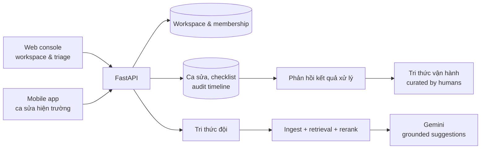

> **Production/HTTPS (28/10/2026):** Root Compose hiện dùng bộ production có secrets/TLS bootstrap. Xem [hướng dẫn triển khai](deploy/production/README.md) và [kết quả audit](docs/FINAL-PRODUCTION-AUDIT.md) trước khi chạy `docker compose up`. Không tự nhập dữ liệu cũ vào volume mới.

# FieldOps — Field Service Intelligence Platform

> **Bản full-stack (11/2026):**
> - Đăng nhập Google và xác thực email, có rate-limit chống dò mật khẩu.
> - Theo dõi chi phí token và server: trang *Chi phí* cho admin, ngân sách ngày, metric Prometheus.
> - Bộ eval tự viết gồm 68 câu, chạy trên CI và hằng đêm với Gemini thật.
> - Pipeline vận hành hằng ngày: KPI, kiểm tra chất lượng dữ liệu, retention, backup.
> - Dashboard và 10 cảnh báo trên Grafana Cloud.
> - Deploy miễn phí lên Oracle Cloud kèm HTTPS.
>
> Hướng dẫn deploy: [deploy/cloud/README.md](deploy/cloud/README.md). Bộ eval:
> [backend/evals/README.md](backend/evals/README.md).


[](https://github.com/YOUR_USERNAME/rag-chatbot/actions/workflows/ci.yml)
[](https://render.com/deploy)

> Nền tảng vận hành dịch vụ hiện trường: workspace đội kỹ thuật, ca sửa, checklist, tri thức dùng chung và trợ lý RAG có dẫn nguồn. Mobile-first cho kỹ thuật viên; web console cho điều phối.

---

## Live Demo

| | URL |
|---|-----|
| **App (UI)** | `https://rag-web.onrender.com` ← thay sau khi deploy |
| **API** | `https://rag-api.onrender.com` |
| **Health** | `https://rag-api.onrender.com/health` |
| **Swagger** | `https://rag-api.onrender.com/docs` |

> **Free tier:** service sleep sau ~15 phút không dùng — lần mở đầu có thể chờ 30–60s.

### Luồng demo sản phẩm

1. Đăng ký hai tài khoản thử nghiệm và tạo workspace đội kỹ thuật.
2. Thêm tài khoản kỹ thuật viên vào workspace.
3. Nạp SOP/manual mẫu vào **Tri thức đội** để các thành viên cùng truy xuất.
4. Tạo ca sửa: triệu chứng, model thiết bị, địa chỉ và thông tin bàn giao từ tổng đài.
5. Mở ca trên mobile: hỏi trợ lý theo tài liệu đội, thêm checklist/ghi nhận, chuyển trạng thái và lưu nhật ký.
6. Dùng web console để theo dõi danh mục ca và workspace.

> Chỉ dùng dữ liệu giả lập/công khai trong demo. Trợ lý hỗ trợ tra cứu và gợi ý; kỹ thuật viên chịu trách nhiệm xác nhận thao tác. Không tự chạy lệnh lên thiết bị.

<!-- Thêm GIF sau khi quay màn hình (15–30s): -->
<!--  -->

---

## Architecture

### Hệ sinh thái FieldOps



**Các lớp sản phẩm:** tổ chức/workspace → danh mục ca sửa → thông tin thiết bị và bàn giao → checklist tại hiện trường → tri thức SOP/manual dùng chung → nhật ký kết quả và cải thiện tri thức. RAG là một lớp hỗ trợ trong vòng vận hành, không phải toàn bộ sản phẩm.

**Phạm vi hiện tại:** workspace, phân quyền thành viên cơ bản, tạo/cập nhật ca, checklist, sự kiện xử lý, thư viện tài liệu workspace và trợ lý theo tài liệu workspace. Ứng dụng iOS/Android lưu bản ca gần đây và hàng đợi checklist/ghi nhận/trạng thái bằng SecureStore (Keychain/Android Keystore); thao tác tự đồng bộ khi ứng dụng mở lại trang ca/danh sách/tổng quan có mạng. Tạo ca mới, thêm bước checklist và hỏi RAG vẫn cần mạng. Web lưu hàng đợi thay đổi ca sửa trong IndexedDB, tách theo API/tài khoản/workspace; chưa có cache ca đầy đủ trên web. Ảnh hiện trường, điều phối lịch tuyến và kết nối CRM/NMS đã có (16/11/2026), xem mục ngay dưới.

**Ảnh hiện trường.**
- Chụp hoặc chọn ảnh ngay trong ca, trên web và app. App giữ ảnh trên máy khi mất sóng rồi tự gửi lại, không tạo trùng.
- Máy chủ mã hoá lại ảnh: xoay đúng chiều, xoá EXIF/GPS. Chỉ nhận JPEG/PNG/WebP thật và giới hạn dung lượng.
- Ảnh tải qua URL ký có hạn 15 phút. Ảnh của ca đã đóng quá `FIELD_PHOTO_RETENTION_DAYS` bị pipeline xoá.

**Điều phối tuyến (`/field/schedule`).**
- Mỗi ca có toạ độ, ưu tiên, khung giờ hẹn khách và thời gian xử lý. Mỗi kỹ thuật viên có điểm xuất phát và ca làm.
- Bộ lập lịch gán ca và xếp thứ tự đi (chèn rẻ nhất + 2-opt): ca khẩn được làm trước, không vi phạm khung giờ hay ca làm. Kết quả hiện trên bản đồ OpenStreetMap.
- Trưởng đội có thể sửa rồi lưu; máy chủ kiểm tra lại tính khả thi trước khi ghi.
- Thời gian đi là ước lượng theo đường chim bay × 1,35, chưa phải dẫn đường thật.

**Kết nối CRM/NMS (`/field/integrations`).**
- Ticket/cảnh báo gửi vào webhook có ký HMAC sẽ tự tạo, cập nhật hoặc đóng ca. Gửi lặp cùng `event_id` thì bỏ qua.
- Khi ca đổi trạng thái, người phụ trách hoặc lịch, FieldOps gửi webhook báo ngược (outbox, tự thử lại; thất bại 8 lần thì vào dead-letter, gửi lại được từ giao diện).
- Có thể thử bằng `backend/scripts/simulate_integration.py`. Chưa có adapter riêng cho một CRM/NMS cụ thể: hệ thống đó cần gửi đúng định dạng webhook chung (xem docstring `backend/field/integrations.py`).


### Medallion pipeline

```
uploads/{user_id}/file.pdf
    → Bronze   raw_documents (metadata + hash)
    → GE       document_chunks_suite validation
    → Silver   document_chunks (cleaned)
    → Gold     document_summary, daily_ingest_stats
    → ChromaDB embedding index (RAG retrieval)
```

---

## Roadmap tuần 1–4 (đã triển khai)

| Tuần | Tính năng | Chi tiết |
|------|-----------|----------|
| 1–2 | **Redis cache** | Cache kết quả retrieve theo `user_id` + hash câu hỏi (`REDIS_URL`, TTL mặc định 300s). Docker Compose có service `redis`. |
| 1–2 | **Cohere Rerank** | Lấy `RETRIEVE_CANDIDATES` chunk (mặc định 15), rerank về `TOP_K` — bật bằng `COHERE_API_KEY`. |
| 3–4 | **OCR ảnh** | Upload PNG/JPG/WebP/GIF → Gemini Vision trích chữ → chunk + embed như TXT. |
| 3–4 | **Auto-suggest** | `GET /documents/suggested-questions` + chip gợi ý trên màn chat. |
| 5–6 | **Analytics** | `GET /analytics/overview`, `/analytics/daily` + trang `/analytics`. |
| 5–6 | **Embed widget** | `POST /embed/tokens`, `GET /embed/widget.js`, iframe `/embed?token=…`. |
| 7–8 | **Stripe** | `POST /billing/checkout`, `/billing/webhook`, gói Free/Pro + hạn mức/ngày. |
| 7–8 | **Public API** | `POST /api-keys`, `POST /v1/ask` (header `X-API-Key`). |

## Tech stack

| Layer | Stack |
|-------|--------|
| Frontend | Next.js 16, React 19, Tailwind 4, shadcn/ui |
| API | FastAPI, LangChain, ChromaDB |
| LLM / Embed | Gemini 2.5 Flash, gemini-embedding-001 |
| App DB | SQLite |
| Warehouse | PostgreSQL (bronze / silver / gold) |
| Orchestration | Apache Airflow |
| Data quality | Great Expectations (suite + checkpoint) |
| Monitoring | Prometheus + Grafana |
| CI | GitHub Actions (pytest, build) |

---

## Deploy live (Render — free)

### Cách 1: Blueprint (khuyên dùng)

1. Push repo lên GitHub  
2. Vào [Render Deploy](https://render.com/deploy) hoặc bấm nút **Deploy to Render** (sửa link repo trong README)  
3. Thêm **Environment** khi deploy:
   - `GEMINI_API_KEY` — [Google AI Studio](https://aistudio.google.com/apikey)
   - `CORS_ORIGINS` — sau khi có URL web, ví dụ: `https://rag-web.onrender.com` (cả http nếu cần)
4. Đợi build ~10–15 phút → copy URL `rag-web` → dán vào mục **Live Demo** ở trên

File cấu hình: [`render.yaml`](render.yaml) (API + Web + PostgreSQL free).

### Cách 2: Railway

1. [railway.app/new](https://railway.app/new) → Deploy from GitHub  
2. Service **backend** — root `backend/`, Dockerfile  
3. Service **frontend** — root `frontend/`, Dockerfile, env `NEXT_PUBLIC_API_URL=https://<backend>.up.railway.app`  
4. Add **PostgreSQL** → gán `POSTGRES_URL`, `MEDALLION_ENABLED=true`  
5. Set `GEMINI_API_KEY`, `SECRET_KEY`

---

## Chạy local

### Một lệnh (Windows — terminal ngoài Cursor)

```powershell
cd d:\self
.\start-web.ps1
```

Hoặc **double-click** file `chay-web.bat` / `start-web.bat` trong thư mục project.

Script sẽ:
- Mở **2 cửa sổ PowerShell** (Backend API + Frontend web)
- Tự chọn cổng web (**3001** nếu **3000** đang là Grafana/Docker)
- **Mở trình duyệt** tới app RAG Chat

| Lệnh riêng | Mô tả |
|------------|--------|
| `cd backend` → `.\start.ps1` | Chỉ API (port 8000) |
| `cd frontend` → `npm run dev` | Chỉ web |

### Yêu cầu

- Python 3.11–3.12, Node 22.13+ cho web/mobile (CI và Docker web dùng Node 22)
- [Gemini API key](https://aistudio.google.com/apikey)

### Quick start (thủ công)

```bash
git clone https://github.com/YOUR_USERNAME/rag-chatbot.git
cd rag-chatbot
cp .env.example .env
# Sửa GEMINI_API_KEY, SECRET_KEY trong .env
```

**Terminal 1 — Backend**

```bash
cd backend
python -m venv .venv
.\.venv\Scripts\activate          # Windows
python -m pip install --upgrade pip
pip install -r requirements.txt
python -B scripts/check_dependencies.py
uvicorn main:app --reload --port 8000
```

**Terminal 2 — Frontend**

```bash
cd frontend
npm ci
npm run dev
```

→ Web http://localhost:3000 (hoặc 3001 nếu 3000 là Grafana) · API http://localhost:8000/docs

### Full DE stack (Docker)

```bash
docker compose up --build
```

| Service | URL |
|---------|-----|
| App | http://localhost:3000 |
| API | http://localhost:8000 |
| Airflow | http://localhost:8080 |
| Grafana (ops only, **không phải app chat**) | http://localhost:3002 — user **`admin`** / pass **`gig`** (xem [TAI-KHOAN.md](TAI-KHOAN.md)) |
| Prometheus | http://localhost:9090 |

---

## Quay GIF demo (cho README)

```bash
# Windows: Xbox Game Bar Win+G, hoặc OBS
# Quay: đăng ký → upload PDF → hỏi → hiện câu trả lời + nguồn
# Lưu: docs/assets/demo.gif (≤ 10MB)
# Bỏ comment dòng ![Demo] ở mục Live Demo
```

---

## API chính

| Method | Path | Auth |
|--------|------|------|
| POST | `/auth/register`, `/auth/login` | — |
| GET | `/auth/me` | ✓ |
| GET/POST/DELETE | `/conversations` | ✓ |
| POST | `/chat/{conv_id}` | ✓ (SSE) |
| POST | `/documents/upload` | ✓ |
| GET | `/documents` | ✓ |
| GET | `/documents/suggested-questions` | ✓ |
| GET | `/analytics/overview`, `/analytics/daily` | ✓ |
| POST/GET/DELETE | `/api-keys` | ✓ |
| POST | `/v1/ask` | API key |
| POST/GET | `/embed/tokens`, `GET /embed/widget.js` | ✓ / — |
| POST | `/billing/checkout`, `/billing/webhook` | ✓ / — |
| GET | `/metrics` | — |
| GET | `/de/gold/stats` | admin |
| GET | `/admin/stats`, `/admin/users` | admin |

---

## Project structure

```
rag-chatbot/
├── backend/           # FastAPI, RAG, Medallion pipeline
│   ├── pipeline/      # bronze → silver → gold
│   ├── validation/    # Great Expectations checks
│   ├── rag/           # ingest, retriever, Gemini chain
│   └── main.py
├── frontend/          # Next.js UI
├── airflow/dags/      # daily_rag_document_ingest
├── gx/expectations/   # GE suite JSON
├── monitoring/        # Prometheus + Grafana
├── tests/             # pytest
├── render.yaml        # Render blueprint
└── docker-compose.yml
```

---

## Tests & CI

```bash
pytest tests/ -v
```

GitHub Actions: `.github/workflows/ci.yml`. CI kiểm tra backend, build web, kiểm thử hàng đợi/streaming và typecheck mobile.

Xem [ghi chú nâng cấp, thay đổi phiên đăng nhập và kiểm tra trước triển khai](docs/UPGRADE-NOTES.md).

Backend có migration theo phiên bản cho SQLite/PostgreSQL và kiểm tra schema trước khi phục vụ API. CI được cấu hình chạy Python 3.11/3.12 với PostgreSQL 16 để kiểm tra migration và quota.

Kiểm tra môi trường bằng `python -B backend/scripts/check_dependencies.py`. Khi nâng cấp từ môi trường cũ, tạo venv mới từ requirements; cài chồng không tự loại bỏ provider/package thừa.

Chuẩn bị đánh giá trên tài liệu thực bằng `python -B backend/scripts/run_rag_evaluation.py --mode validate-only`. Mẫu `backend/evaluation/rag-real.template.json` cần được thay bằng câu hỏi và nguồn/trang do người phụ trách xác nhận; xem hướng dẫn Đợt 3 trong ghi chú nâng cấp. Lệnh mặc định chỉ xác minh dữ liệu, không gọi API.

Quota hiện được lưu độc lập với lịch sử chat và dùng chung cho các đường gọi RAG. File/index có journal phục hồi khi worker bị gián đoạn; startup kiểm tra phục hồi trước khi phục vụ API.

Benchmark truy xuất tổng hợp FieldOps (offline, không gọi LLM/API) được chạy trong CI:

```powershell
.\backend\.pytest_security_runtime_tmp\.venv\Scripts\python.exe -B backend/scripts/run_eval_benchmark.py --offline --output fieldops_eval_results.json --fail-on-regression
```

---

## Ghi chú production / demo

- RAG chỉ trả lời theo **tài liệu đã upload**, không phải kiến thức chung  
- Gemini free tier: giới hạn embedding/phút — upload file lớn cần chờ  
- Render free: disk ephemeral — dữ liệu có thể mất khi redeploy (OK cho demo CV)

---

## License

MIT

Bản vá dependency ngày 22/10/2026 và các advisory chưa có bản sửa được ghi tại [DEPENDENCY-SECURITY.md](docs/DEPENDENCY-SECURITY.md).

Hướng phát triển RAG, các lỗi luồng trả lời đã sửa và thứ tự nâng chất lượng được ghi tại [RAG-ROADMAP.md](docs/RAG-ROADMAP.md).

Bộ [8 SOP/manual FieldOps giả lập và 60 câu hỏi](examples/fieldops-sop-demo/README.md), cùng [hướng dẫn gán nhãn/chấm RAG và evidence](docs/RAG-EVALUATION-GUIDE.md), đã sẵn sàng dùng thử.
