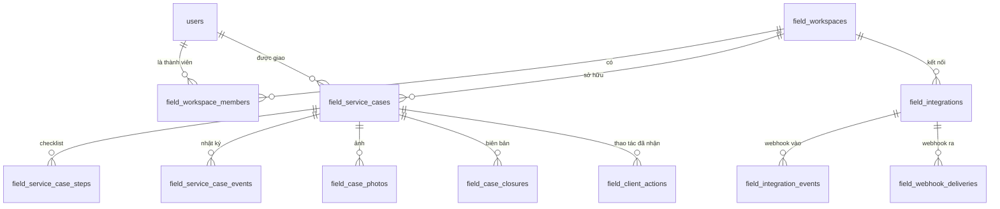

# Cơ sở dữ liệu FieldOps

FieldOps có hai nơi lưu dữ liệu có cấu trúc, cộng thêm phần tệp:

| Nơi lưu | Dùng cho | Cấu hình |
|---|---|---|
| **CSDL ứng dụng** — SQLite mặc định (`DATA_ROOT/app.db`), hoặc PostgreSQL | người dùng, đội, ca sửa, nhật ký, chi phí AI, tích hợp | `DATABASE_URL` (`backend/config.py`) |
| **Kho dữ liệu Medallion** — PostgreSQL, schema `bronze` / `silver` / `gold` | pipeline nạp tài liệu và thống kê nạp hằng ngày | `infra/postgres/init.sql`, bật bằng `MEDALLION_ENABLED` |
| **Tệp** | tài liệu tải lên, ảnh hiện trường, chỉ mục vector ChromaDB | thư mục dữ liệu; CSDL chỉ giữ khoá tham chiếu (`storage_key`, `sha256`) |

Lý do dùng SQLite một tiến trình ghi và giới hạn của nó: xem quyết định 9 trong
[DECISIONS.md](DECISIONS.md).

## 1. Các bảng của CSDL ứng dụng

Mô hình nằm trong `backend/*/models.py` (SQLAlchemy). Chỉ liệt kê cột quan trọng.

### Lõi hiện trường (`backend/field/models.py`)

| Bảng | Cột chính | Khoá và ràng buộc |
|---|---|---|
| `field_workspaces` (đội) | `name`, `created_by` | PK `id`; FK `created_by → users` |
| `field_workspace_members` | `workspace_id`, `user_id`, `role` (`owner` = trưởng đội, `technician`), điểm xuất phát, giờ ca làm | duy nhất (`workspace_id`, `user_id`) — `uq_field_workspace_user` |
| `field_service_cases` (ca sửa) | `title`, `customer_label`, `address`, `device_model`, `serial_number`, `symptom`, `status`, `assigned_to`, toạ độ, ưu tiên, khung giờ hẹn, `external_source`, `external_ref`, `external_updated_at`, `resolved_at` | FK `workspace_id`, `created_by`, `assigned_to → users`; duy nhất (`workspace_id`, `external_source`, `external_ref`) — `ix_field_case_external` |
| `field_service_case_steps` (checklist) | `title`, `instruction`, `source` (tài liệu căn cứ), `status`, `result_note`, `position`, `completed_by`, `completed_at` | FK `case_id` |
| `field_service_case_events` (nhật ký ca) | `actor_id`, `event_type`, `detail`, `evidence_json` (bằng chứng RAG lưu cố định) | FK `case_id`, `actor_id` |
| `field_client_actions` (chống gửi trùng) | `client_action_id`, `action_type`, `request_hash`, `result_id` | PK `client_action_id` |
| `field_case_photos` | `storage_key`, `sha256`, `content_type`, `size_bytes`, `width`, `height`, `client_action_id` | duy nhất `storage_key`, `client_action_id` |
| `field_case_closures` (biên bản đóng ca) | `outcome_code`, `note`, `customer_name`, `signature_photo_id`, `signed`, `closed_by` | duy nhất `client_action_id`; mở lại rồi đóng thì thêm bản mới, bản cũ giữ làm lịch sử |
| `field_integrations` (kết nối CRM/NMS) | `kind`, `public_id`, `secret` (khoá HMAC), `outbound_url`, `default_assignee` | duy nhất `public_id` |
| `field_integration_events` (webhook vào) | `event_id`, `event_type`, `case_id`, `outcome` | duy nhất (`integration_id`, `event_id`) — chống xử lý lặp |
| `field_webhook_deliveries` (webhook ra, outbox) | `payload_json`, `status` (`pending`/`delivered`/`dead`), `attempts`, `next_attempt_at` | FK `integration_id` |
| `field_push_devices`, `field_push_outbox` | token Expo push; hàng đợi thông báo đẩy | duy nhất `token`; xoá theo người dùng (`ON DELETE CASCADE`) |
| `field_geocode_cache` | kết quả tra địa chỉ (chỉ lưu hash của địa chỉ) | duy nhất (`workspace_id`, `query_hash`) |

Trạng thái ca có 5 giá trị: `open`, `in_progress`, `waiting`, `escalated`, `resolved`. Danh sách
này được kiểm ở tầng ứng dụng (`CASE_STATUSES` trong `backend/field/schemas.py`), không có ràng
buộc CHECK trong CSDL. Cột `resolved_at` được tự đặt khi ca chuyển sang `resolved` và tự xoá khi
mở lại.

### Tài khoản và bảo mật (`backend/auth/models.py`)

| Bảng | Ghi chú |
|---|---|
| `users` | `email` duy nhất, `hashed_password`, `role`, `token_version` (thu hồi phiên), `google_sub` duy nhất, `email_verified_at`, `deleted_at`, `privacy_version` |
| `password_reset_tokens` | chỉ lưu hash của mã (`token_hash` là khoá chính) |
| `user_consents` | lịch sử đồng ý chính sách quyền riêng tư |
| `signup_invites` | lời mời đăng ký; chỉ lưu SHA-256 của mã (`code_hash` duy nhất), dùng một lần |

### Trợ lý, chi phí, vận hành

| Bảng | Ghi chú |
|---|---|
| `conversations`, `messages` | hội thoại trợ lý; `messages.evidence_json` giữ bằng chứng đã dùng để trả lời, điểm AI chấm (`eval_faithfulness`, `eval_relevancy`) |
| `llm_usage_events`, `llm_budget_reservations`, `infra_costs` | chi phí AI theo từng lượt gọi, giữ chỗ ngân sách, chi phí hạ tầng theo tháng |
| `daily_query_usage` | hạn mức câu hỏi theo ngày; khoá chính (`user_id`, `usage_date`), CHECK `used_queries >= 0` |
| `api_keys`, `embed_tokens`, `embed_guest_sessions` | API công khai và widget nhúng; chỉ lưu hash của khoá/token |
| `pipeline_runs`, `analytics_daily` | lịch sử chạy job hằng ngày và KPI tổng hợp theo ngày |
| `schema_migrations` | sổ ghi các phiên bản migration đã chạy (xem mục 4) |

## 2. Sơ đồ quan hệ phần hiện trường

## 3. Cách ly dữ liệu giữa các đội

- Mọi ca sửa thuộc một `workspace_id`. Trước mỗi truy vấn, máy chủ kiểm tra người dùng có trong
  `field_workspace_members` của đội đó (ví dụ `_member_role` trong `backend/field/router.py`);
  người ngoài đội không mở được ca kể cả khi biết số ca.
- Trưởng đội (`role = owner`) mới được giao ca cho người khác, tải lên hoặc xoá tài liệu dùng chung.
- Tài liệu và vector nằm ở collection ChromaDB riêng cho từng đội (`workspace_{id}`); tài liệu cá
  nhân ở `user_{id}`. Khoá bộ nhớ đệm cũng có `workspace_id`.
- Cách ly được làm ở tầng ứng dụng. CSDL chưa có Row-Level Security; với SQLite thì không có cơ
  chế này.

## 4. Tạo và nâng cấp schema

FieldOps **không dùng Alembic**. Thay vào đó có một bộ migration tự viết, có đánh số phiên bản,
trong `backend/schema_migrations.py`. Khi API khởi động, `init_db()` trong `backend/database.py`
gọi `run_migrations`:

1. Khoá CSDL trong suốt quá trình: SQLite dùng `BEGIN IMMEDIATE`; PostgreSQL dùng advisory lock
   và `lock_timeout = 30s`. Nhiều tiến trình khởi động cùng lúc thì chỉ một tiến trình chạy
   migration.
2. Đọc bảng `schema_migrations`. Gặp phiên bản lạ hoặc tên không khớp thì dừng hẳn, không phục vụ.
3. Chạy lần lượt các migration chưa có. Hiện có 10 bản, từ `1 legacy_identity_and_message_columns`
   đến `10 field_case_external_updated_at`.
4. `metadata.create_all` tạo bảng còn thiếu. Sau đó kiểm tra mọi cột trong mô hình đều có trong
   CSDL; thiếu cột thì báo lỗi và đòi viết migration riêng.
5. Mọi bước nằm trong một giao dịch: lỗi ở đâu thì hoàn tác toàn bộ.

SQLite được bật khoá ngoại (`PRAGMA foreign_keys=ON`), chế độ WAL và chờ khoá 30 giây. CI chạy kiểm
tra migration trên cả PostgreSQL 16.

Kho Medallion được tạo bằng `infra/postgres/init.sql` (`CREATE ... IF NOT EXISTS`); khi chạy local
không qua Docker, `backend/pipeline/db.py` tự chạy file này nếu bảng chưa có.

## 5. Kho dữ liệu Medallion (PostgreSQL)

| Bảng | Nội dung | Ràng buộc |
|---|---|---|
| `bronze.raw_documents` | tệp gốc: tên, đường dẫn, kích thước, hash nội dung | duy nhất (`user_id`, `filename`, `content_hash`) |
| `bronze.ingest_runs` | mỗi lần chạy nạp: trạng thái, số tệp, lỗi | — |
| `silver.document_chunks` | đoạn văn bản đã làm sạch | FK `bronze_id → bronze.raw_documents` (`ON DELETE CASCADE`); duy nhất (`user_id`, `source`, `content_hash`) |
| `gold.document_summary` | số đoạn và số ký tự theo tài liệu | PK (`user_id`, `source`) |
| `gold.daily_ingest_stats` | thống kê nạp theo ngày | PK `metric_date` |

Trước khi vào `silver`, dữ liệu qua bộ kiểm tra chất lượng `gx/expectations/document_chunks_suite.json`
(số dòng trong khoảng cho phép, không rỗng, không trùng).

## 6. Sao lưu và khôi phục

- Job `backup` hằng ngày (`backend/pipeline/jobs/tasks.py`) sao lưu SQLite bằng online backup API và
  nén chỉ mục Chroma, ảnh, tệp tải lên; giữ `BACKUP_KEEP` bản gần nhất (mặc định 7) trong `BACKUP_DIR`.
- `backend/pipeline/jobs/restore.py` khôi phục một bộ sao lưu: kiểm `PRAGMA integrity_check` và từng
  tệp nén trước khi đụng vào dữ liệu đang dùng; dữ liệu hiện tại được chuyển sang
  `pre-restore-<thời điểm>/` chứ không bị xoá; bắt buộc `--yes` hoặc `--dry-run`.
- Nếu `BACKUP_DIR` nằm trong thư mục dữ liệu, job sẽ cảnh báo: cần đặt ra ổ khác hoặc đồng bộ ra
  ngoài máy.

## 7. Việc bảo trì còn mở

- Migration chỉ có chiều nâng cấp, không có chiều hạ cấp. Muốn quay lại thì khôi phục từ bản sao
  lưu. Cân nhắc chuyển sang Alembic khi lên PostgreSQL thật.
- Trạng thái ca và trạng thái bước checklist chỉ kiểm ở tầng ứng dụng; có thể thêm ràng buộc CHECK.
- Bảng `field_client_actions` chưa có job dọn bản ghi cũ.
- Một số cột tham chiếu người dùng (ví dụ `llm_usage_events.user_id`, `infra_costs.created_by`) là số
  nguyên không có khoá ngoại.
