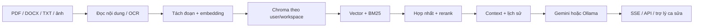

# Hướng phát triển và sửa lỗi RAG — 26/10/2026

## Hệ thống đang có gì

Đây là ứng dụng RAG có giao diện web/mobile, tài liệu riêng theo user hoặc workspace, chat, widget, API và trợ lý ca sửa FieldOps. Các đợt trước sửa nền tảng bảo mật, quota, ghi tài liệu và migration; chúng chưa chứng minh chất lượng trả lời trên dữ liệu thật.

Ollama hiện phụ trách sinh văn bản. Embedding và OCR trong repo vẫn dùng Gemini; chế độ sinh văn bản local chưa đồng nghĩa toàn bộ pipeline chạy offline. Khi không gọi được embedding lúc hỏi, hybrid retriever có thể dùng nhánh BM25 của index đã có.

## Lỗi đã sửa trong đợt này

| Lỗi đã xác định | Hậu quả trước sửa | Hành vi sau sửa |
|---|---|---|
| Provider lỗi nhưng chain phát token chứa lỗi rồi phát done | Nội dung lỗi có thể được lưu thành assistant answer, lộ chi tiết provider | Phát lỗi công khai cố định; không done/không lưu assistant thành công |
| Luồng đồng bộ tiếp tục sinh khi client ngắt; buffer không giới hạn | Giữ worker, tích token và tài nguyên cho câu trả lời không còn được đọc | Buffer hữu hạn, tín hiệu dừng, đóng iterator trong thread sở hữu; slot giữ đến khi worker thật sự thoát |
| Ollama trả error trong NDJSON với HTTP 200 hoặc stream kết thúc thiếu done | Có thể trả câu trả lời thiếu/như thành công | Nhận diện error, nội dung sai kiểu và kết thúc không hoàn tất |
| Gemini stream không kiểm tra kết thúc bình thường | Câu trả lời bị cắt/chặn có thể trông như hoàn tất | Chỉ coi stream có finish reason STOP là hoàn tất; luôn đóng iterator request |
| Khóa cache nối source/query bằng dấu hai chấm | Hai cặp nguồn/câu hỏi khác nhau có thể dùng chung kết quả | Mã hóa cấu trúc trước khi hash; namespace v2 bỏ qua entry cũ |
| Redis không giới hạn chờ I/O | Cache phụ có thể giữ truy xuất chờ quá lâu | Connect/read timeout 0,3 giây; cache lỗi thì bỏ qua |
| Chat/widget/API luôn đòi Gemini key dù chọn Ollama | Chặn chế độ sinh văn bản local trước khi vào chain | Kiểm tra key theo provider đã chọn |
| Model trả rỗng/lỗi trong trả lời một lần | Câu trả lời rỗng hoặc lỗi không rõ trạng thái | API/trợ lý ca sửa trả 503 an toàn, không lưu recommendation thành công |

Đã tái hiện hai lỗi chain/cache bằng test thất bại trước khi sửa. Kiểm tra sau sửa dùng provider giả lập và DB riêng; không gọi model trả phí hoặc sửa dữ liệu ứng dụng.

Chat và widget chỉ lưu assistant sau khi provider hoàn tất và bước lưu thành công; lỗi lưu cũng không phát done. User question đã được nhận và quota đã giữ vẫn tồn tại khi model lỗi, theo chính sách accepted-attempt của Đợt 2. UI có thể đã hiển thị partial text trước sự kiện error; partial text đó không trở thành assistant history thành công.

### Giới hạn hủy request và timeout

- Mỗi process tối đa 8 worker stream model. Mỗi buffer giữ 16 đoạn tối đa 512 ký tự; không phải giới hạn tổng dung lượng câu trả lời được lưu hoặc toàn bộ bộ nhớ SDK.
- Không cưỡng chế dừng thread đang chờ socket read. Client có thể kết thúc trước; worker giữ slot đến khi I/O trở về và cleanup xong. Iterator chỉ được đóng trong thread sở hữu, không đóng Gemini client dùng chung để hủy một request.
- LLM_REQUEST_TIMEOUT_SEC mặc định 60 giây, hữu hạn và ít nhất 0,001 giây. Đây là timeout I/O cho Gemini/Ollama, cũng áp dụng những lời gọi dùng chung client như OCR; không phải deadline cứng của toàn bộ câu trả lời. Retry của SDK hoặc luồng liên tục nhận dữ liệu có thể kéo dài thời gian tổng. Cần cấu hình theo số đo thực tế của model/máy chạy.
- Khi client ngắt sau thời điểm DB đã commit, không thể bảo đảm thu hồi câu trả lời đã lưu. Kiểm thử xác nhận không lưu assistant khi ngắt đã được quan sát trước bước hoàn tất.
- Cache v2 sẽ lạnh một lần sau nâng cấp; entry cũ hết TTL hoặc được invalidation hiện có dọn theo scope.

Căn cứ protocol: [Ollama streaming errors](https://docs.ollama.com/api/errors) mô tả lỗi NDJSON sau HTTP 200; [Gemini FinishReason](https://ai.google.dev/api/generate-content#FinishReason) phân biệt dừng bình thường với giới hạn/chặn. Việc xử lý đã được kiểm tra thêm trên API của SDK đang cài trong môi trường backend.

## Phần chất lượng chưa được xác nhận

1. Chưa có bộ câu hỏi và bằng chứng trên tài liệu thật được người phụ trách gán nhãn. Kết quả BM25 16/16 là fixture tổng hợp, không phải độ chính xác câu trả lời thực tế.
2. Vector search vẫn trả ứng viên gần nhất. Có chunk không đồng nghĩa có đủ bằng chứng; hiện chưa có ngưỡng từ chối được hiệu chỉnh trên dữ liệu thật.
3. Đợt 6 đã thêm đoạn trích, trang, phiên bản và kiểm tra nhãn citation. Chưa xác minh về ngữ nghĩa rằng từng phát biểu thực sự được các đoạn nguồn hỗ trợ.
4. Điểm overlap trong grounding.py và LLM-as-judge là chẩn đoán; không thay thế người đánh giá correctness/safety. Câu trả lời đúng từ khóa vẫn có thể sai số liệu, phủ định hoặc phạm vi áp dụng.
5. Prompt/context/lịch sử đang ghép dạng text. Cần kiểm tra tài liệu chứa chỉ dẫn đánh lừa, lịch sử sai và câu hỏi ngoài phạm vi trước khi dựa vào prompt để kiểm soát câu trả lời.
6. OCR, bảng PDF, tiêu đề và model/phiên bản thiết bị cần đánh giá theo loại tài liệu thật; lỗi trích xuất có thể làm retrieval và câu trả lời sai dù model hoạt động bình thường.

## Thứ tự phát triển đề xuất

| Ưu tiên | Kết quả cần làm | Cách nghiệm thu |
|---|---|---|
| P0 — độ tin cậy luồng trả lời | Bản sửa lỗi trong đợt này, regression stream/provider/cache/DB | Không báo thành công khi provider/commit lỗi; hủy không tạo thêm worker vô hạn; quota và quyền truy cập giữ đúng |
| P1 — bộ đánh giá thực | Bắt đầu với 50–100 câu được người phụ trách xác nhận, gồm có/thiếu bằng chứng, mã lỗi gần nhau, câu hỏi nhiều lượt, sai nguồn và phiên bản cũ | Có source/page/reviewer; giữ tập holdout; đo Recall@k, MRR, trả lời đúng, trích dẫn đúng, từ chối đúng; so từng thay đổi với baseline |
| P1 — bằng chứng có thể kiểm tra | Bổ sung evidence có chunk ID, source, page, revision, đoạn trích; giữ sources hiện có để client cũ tương thích | UI mở đúng trang/đoạn; chỉ chấp nhận citation thuộc context của request; tài liệu đổi phiên bản thì evidence không bị gán nhầm |
| P2 — truy xuất theo tài liệu thực | Thử chunk theo mục/bảng, nối thông tin model/phiên bản; hiệu chỉnh hybrid/rerank và điều kiện thiếu bằng chứng | Cải thiện trên holdout; kiểm tra riêng exact-code, không bằng chứng, lọc nguồn và workspace; không tự đặt chung một ngưỡng cho BM25/cosine/rerank |
| P2 — ngữ cảnh hội thoại và prompt | Tách instruction khỏi tài liệu/lịch sử ở provider; giới hạn context; đánh giá truy vấn tiếp nối và chỉ dẫn đánh lừa trong tài liệu | Có bộ regression đối kháng; theo dõi lỗi theo câu; không coi prompt là ranh giới quyền truy cập |
| P3 — vận hành pilot | Job ingest có trạng thái/retry theo revision, trace lỗi không ghi secret, p50/p95/TTFT và chi phí; staging backup/restore và thiết bị offline | Có báo cáo theo phiên bản; diễn tập phục hồi trên bản sao; kiểm tra quyền/nguồn sau sync; ngân sách chi phí do người vận hành đặt |

Ưu tiên tiếp theo là dữ liệu đánh giá và trích dẫn. Dùng số đo của hệ thống hiện có để quyết định thay model, cách chunk hoặc kho vector. Mức đạt chất lượng phải được chốt sau khi có baseline và yêu cầu nghiệp vụ; chưa có cơ sở khẳng định hệ thống đạt một phần trăm độ chính xác cụ thể.

## Công cụ đã có để bắt đầu P1

- Dataset/schema: backend/evaluation/rag-real.template.json và rag-real.schema.json. Template hiện chưa phải dữ liệu thật. Điền query và evidence từ tài liệu được phép dùng, có người xác nhận, rồi đặt kind=user_curated.
- Runner: backend/scripts/run_rag_evaluation.py. Mặc định validate-only, không gọi model/index. Retrieval cần --allow-external-calls; sinh câu trả lời cần thêm --generate. Chỉ chạy khi người vận hành cho phép API/model tương ứng.
- Giữ fingerprint dataset/code và revision collection trong report; chia lỗi extraction/retrieval/generation/citation để biết sửa ở đâu. Runner hiện không thay thế kiểm tra membership của ứng dụng; chỉ người vận hành được cấp quyền mới chạy trên collection tương ứng.
- Bộ dữ liệu riêng ở evaluation.local/ đã gitignore. Không đưa tài liệu nhạy cảm, secret hay nội dung khách hàng vào fixture công khai.

## Trước khi mở rộng pilot

Thử startup/migration và backup/restore trên bản sao nhất quán. Chạy E2E bằng cấu hình staging riêng; kiểm tra upload → hỏi → nguồn, cập nhật/xóa tài liệu, thu hồi quyền, lỗi provider và offline/reconnect trên thiết bị thật. Các bước này chưa được coi là hoàn tất bởi unit test hoặc export bundle.

Các advisory dependency chưa giải quyết được ghi theo ảnh chụp 22/10/2026 trong DEPENDENCY-SECURITY.md và audit-summary.json. Đợt sửa RAG không phải một lần audit dependency mới; cần quét lại trước phát hành. Medallion và kho raw/index vẫn chưa chung transaction nguyên tử.

## Kết quả xác minh ngày 26/10/2026

- Windows/Python 3.12.4 trong backend/.pytest_security_runtime_tmp/.venv: 304 test backend qua, gồm 10 test PostgreSQL 16; không failure/error/skip. So với đợt trước có thêm 32 ca regression. Một warning SHA384 dự kiến thuộc test từ chối sai thuật toán JWT.
- 14 test client qua, gồm SSE lỗi/EOF/hủy, auth và outbox. git diff --check hợp lệ.
- Ca RAG mới xác minh: provider lỗi sau partial text; stream rỗng; backpressure không mất/trùng text; hủy lúc buffer đầy/đang read và giữ capacity; đóng iterator Gemini; Gemini STOP/SAFETY/MAX_TOKENS/thiếu marker và trailing usage; Ollama error/thiếu done; Redis nhận kết nối nhưng không trả lời; chat/widget không done/không lưu assistant khi model hoặc transaction lỗi; API/field trả 503; chế độ Ollama không bị chặn bởi guard Gemini.
- JUnit: backend/.pytest_rag_phase5_verified_tmp/results.xml, artifact cục bộ được gitignore. PostgreSQL chạy container tạm, data trên tmpfs và port loopback, không gắn dữ liệu ứng dụng; đã dừng sau kiểm thử.
- Không gọi model/embedding/OCR trả phí, không ingest tài liệu thật, không thay dữ liệu app.db, không deploy production. Chưa kiểm chứng chất lượng câu trả lời hoặc E2E trên thiết bị thật trong đợt này.

## Đợt 6: công cụ P1 và bộ SOP mẫu

Đã triển khai evidence snapshot có ID chunk thật khi có, source/page/version/hash và quote; giữ sources cho client cũ. Snapshot được lưu cùng chat message/case event qua migration 3, hiển thị trên web/mobile/widget và giữ qua reload. Kiểm tra phiên bản nguồn yêu cầu quyền hiện tại; source lịch sử không được thay bằng file mới cùng tên. Marker 【E1】 tách khỏi mã lỗi [E204]; nhãn không có trong context không được lưu thành câu trả lời thành công. Đúng nhãn chưa chứng minh đúng ngữ nghĩa.

Workflow offline gồm duyệt annotation, tách dev/holdout, export manifest, chấm correctness/citation/safety/refusal và score gắn với fingerprint đúng run/answer. Ca chưa chấm không tạo headline accuracy; outage được thống kê riêng và tính zero trên mẫu số kế hoạch.

Theo yêu cầu người dùng, đã tạo 8 SOP/manual giả lập và 60 câu hỏi ứng viên tại examples/fieldops-sop-demo. Tất cả vẫn chưa có phê duyệt chuyên môn. Bộ mẫu không phải tài liệu thực của hãng và không phải phép đo chất lượng trả lời thực tế. [Hướng dẫn và giới hạn](RAG-EVALUATION-GUIDE.md).

Xác minh: 343 test backend gồm 10 PostgreSQL qua; 14 client test qua; web build/typecheck và mobile typecheck/export Android/iOS/web qua; 6 tình huống Chrome dùng API giả lập qua. BM25 mẫu hoàn tất 60/60, Recall@3=1.0, MRR@3=0.9792, empty-retrieval detection=4/12. Còn 8 câu thiếu thông tin vẫn có đoạn trùng từ; không suy ra LLM sẽ trả lời hoặc từ chối đúng.

## Technical RAG opt-in — 26/10/2026

Đã có mã riêng tại `backend/rag/technical/`: layout HTML bảng, section parent–child, SQLite BM25 + Chroma child vectors chạy song song, RRF, real cross-encoder local/Cohere v2, và LangChain chọn ID để server trả nguyên văn parent. Scope thiết bị/revision bắt buộc; approval hash bao extraction và metadata; index publication theo generation.

64 test mô-đun qua với profile LangChain 1.7.0/Pydantic 2.14.1; 159 regression RAG qua trên môi trường ứng dụng. Providers inference giả lập, SQLite/Chroma thật; chưa chạy OCR/LLM/BGE thật hay đánh giá chất lượng trên manual nhà sản xuất. Chưa thay endpoint chat, reindex uploads hoặc triển khai. Xem [hướng dẫn đầy đủ](TECHNICAL-RAG.md).

## Final Production Audit — 28/10/2026

Nginx HTTPS, Compose isolation/file secrets, Redis/Kafka lifecycle, Telecom fail-open và Celery recycle/cgroup đã có source/test. Xem [báo cáo phạm vi và giới hạn](FINAL-PRODUCTION-AUDIT.md); không suy ra zero-CVE, HA hoặc độ chính xác model từ kết quả vận hành.
