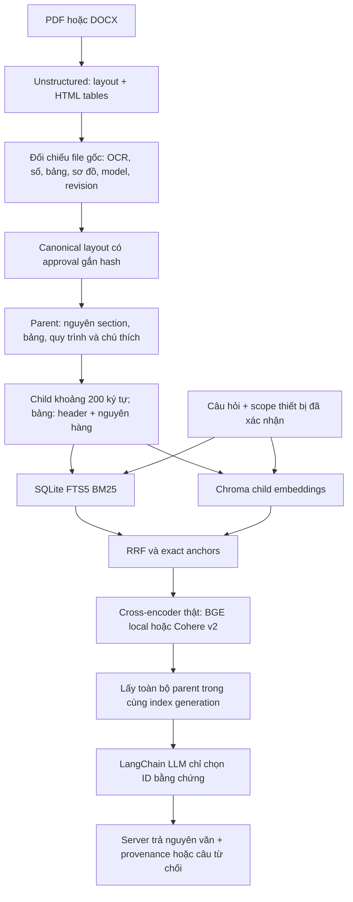

# Technical RAG cho FieldOps — 26/10/2026

Mã hoàn chỉnh nằm trong `backend/rag/technical/`, CLI trong `backend/scripts/technical_rag.py`.
Đây là mô-đun opt-in: chưa thay endpoint chat hiện tại và chưa reindex dữ liệu ứng dụng.

BM25 là thuật toán **truy xuất/xếp hạng từ khóa**, không phải thuật toán chia chunk.
Vector search bỏ sót mã chính xác là lỗi retrieval; hallucination thường là lỗi sinh câu trả lời
hoặc suy diễn từ bằng chứng sai/thiếu. Hybrid cải thiện recall, không tự chứng minh đáp án đúng.



## Quyết định kiến trúc

- **A + B:** Unstructured giữ loại block và HTML bảng; cấu trúc cha–con giữ ngữ cảnh
  khi lấy kết quả. Không stringify bảng thành văn xuôi. `table_layout()` giữ ô rỗng,
  thứ tự cột, header và toàn hàng; merged cells, bảng lệch cột, markup không hỗ trợ
  phải được chép lại thành biểu diễn đã kiểm tra. Không tự đọc ra thông số từ sơ đồ.
- **Kích thước mềm:** child khoảng 200 ký tự, overlap hai token nguyên vẹn; một hàng
  có header có thể dài hơn. Parent là nguyên section được reviewer xác nhận, thường
  khoảng 2.000 ký tự. Bảng/quy trình dài hơn vẫn giữ nguyên. Không tự chia thêm parent
  chỉ để đạt 2.000; quá hard limit 12.000 thì báo lỗi để rà lại ranh giới cấu trúc.
- **BM25 trên đĩa:** dùng SQLite FTS5 `bm25()`, điểm nhỏ hơn tốt hơn; tokens được encode
  trước MATCH để bảo toàn model có dấu gạch và tránh syntax injection. Đây là BM25
  thực, không cần nạp toàn bộ corpus thành `rank_bm25` trong RAM. LangChain cung cấp
  Embeddings, prompt, structured output; hợp nhất RRF được triển khai trực tiếp.
- **Hybrid song song:** hai nhánh dùng chung executor giới hạn; RRF dedupe child ID
  theo từng ranking, cộng `1/(60+rank)`. Không cộng mọi child để ưu ái parent dài.
- **Cross-encoder bắt buộc:** cả khi chỉ có một ứng viên; lỗi không fallback lexical.
  Local adapter dùng tokenizer + sequence-classification model của Transformers,
  `truncation=False`, kiểm tra cả query/document/special tokens, logits đơn, score hữu hạn.
- **Mã/số chính xác:** phân biệt E01/E1, 504/5040, A/mA và dấu âm. So khớp chuỗi số
  gốc bảo thủ: 0.50 A không tự coi bằng 0.5 A, không đổi đơn vị, không sửa OCR O/0.
  Dấu phẩy thập phân trong query có đơn vị bị từ chối để xác nhận cách ghi. Bộ regex
  chỉ là guard bổ sung, chưa bao quát mọi ký hiệu đo, biểu thức phạm vi hoặc thuật ngữ.
- **Parent snapshot:** BM25, child vector, parent và approvals cùng generation. Xây
  đủ rồi compare-and-swap active pointer dưới file lock; reader pin một generation.
  Không garbage-collect generation cũ khi reader còn dùng. Chưa kiểm thử mất điện;
  atomic rename/fsync pointer không phải chứng minh durability của mọi filesystem.
- **Scope bắt buộc:** tenant, workspace, vendor, model, hardware revision, manual
  revision lấy từ xác thực/asset đã xác nhận của ứng dụng, không suy ra bằng LLM.
  Bảng nhiều model/điều kiện phải tách thành vùng được review đúng asset; chưa xác
  định thì giữ unreviewed. Nhiều source phù hợp thì yêu cầu source_id rõ ràng.

## Mã nguồn

| File | Vai trò |
|---|---|
| `backend/rag/technical/models.py` | Scope, canonical hash, approval, parent/child, schema câu trả lời |
| `backend/rag/technical/layout.py` | PDF hi_res/DOCX -> layout/HTML; duyệt gắn raw/extraction hash |
| `backend/rag/technical/chunking.py` | Section nguyên tử, child source offsets, header + row |
| `backend/rag/technical/store.py` | Build/publish snapshot, SQLite BM25, Chroma vectors, resolve parent |
| `backend/rag/technical/adapters.py` | BGE local, Cohere v2, Ollama embeddings, LangChain selector/prompt |
| `backend/rag/technical/pipeline.py` | Hybrid/RRF, guards, rerank, parent expansion, trích dẫn nguyên văn |
| `backend/scripts/technical_rag.py` | extract / approve / build / ask |
| `tests/test_technical_rag.py` | Kiểm thử offline, SQLite/Chroma thật, provider giả lập |

## Cài đặt riêng, tránh trộn phụ thuộc ứng dụng

Python 3.12, SQLite có FTS5. Các top-level package đã đối chiếu PyPI ngày 26/10/2026;
profile này đã cài sạch, `pip check` qua. Không cài chồng lên requirements ứng dụng.

```powershell
py -3.12 -m venv .technical-runtime/.venv
.technical-runtime/.venv/Scripts/python.exe -m pip install -r backend/requirements-technical-rag-dev.txt
```

Ingestion worker PDF/DOCX, nên đóng gói Linux riêng với Poppler/Tesseract và OCR language
packs phù hợp (`vie`, `eng`); hi_res có thể cần tải layout model lần đầu:

```powershell
.technical-runtime/.venv/Scripts/python.exe -m pip install "unstructured[pdf,docx]==0.27.34"
```

Inference worker dùng local cross-encoder:

```powershell
.technical-runtime/.venv/Scripts/python.exe -m pip install "transformers==5.20.2" "torch==2.14.1"
```

Cần chuẩn bị riêng model safetensors + tokenizer đã pin weights revision. Runtime đặt
`local_files_only=True`, `trust_remote_code=False`, không tự tải model. `bge-reranker-large`
được hỗ trợ; ưu tiên đánh giá `bge-reranker-v2-m3` cho tiếng Việt vì model đa ngôn ngữ.
Không tuyên bố local model đã chạy trên phần cứng này: chưa tải weights hoặc Torch.

Tùy chọn Cohere đã dùng HTTP `/v2/rerank` và model `rerank-v5.0-pro`; có thể truyền
`rerank-v5.0-fast` khi phù hợp holdout. SDK Cohere không bắt buộc. Adapter đặt rõ
`max_tokens_per_doc=8192` và giới hạn byte query/doc; tokenization phía dịch vụ không
được kiểm chứng độc lập. Local BGE có tokenizer gate chính xác hơn cho yêu cầu này.

Trên Windows này wheel grpcio 1.85 bị Application Control chặn DLL; profile pin wheel
1.84 đã chạy được. Không thay policy Windows. Chroma 1.5.9 vẫn có advisory chưa vá đã
ghi trong `DEPENDENCY-SECURITY.md`: chỉ dùng local PersistentClient, không expose HTTP
hay cho client chọn embedding config. Phiên bản mới nhất không đồng nghĩa audit sạch.

## Ingest và review

Chạy các lệnh từ thư mục gốc repo. Sao chép `examples/technical-rag/scope.json` thành
scope của thiết bị thật. Không dùng fixture giả làm hồ sơ nhà sản xuất.

```powershell
.technical-runtime/.venv/Scripts/python.exe backend/scripts/technical_rag.py extract manual.pdf --scope scope.json --source-id manual-vendor-model-r1 --out layout.unreviewed.json
```

Đối chiếu JSON với trang gốc trước khi approve:

1. Chữ số, dấu âm, đơn vị, ≤/≥, mã model/mã lỗi, ký tự OCR, mọi header/ô trống/chú thích.
2. Gom cùng `section` mọi điều kiện + cảnh báo + các bước + chú thích liên quan.
   Tiêu đề lặp hoặc bảng nối trang không được làm tách đôi quy trình/bảng.
3. Sơ đồ/hình/công thức chưa hỗ trợ ở `kind=diagram`: thay bằng bản chép có kiểm chứng
   hoặc giữ chưa duyệt; không đánh dấu đã hiểu hình chỉ vì parser chạy xong.
4. Xác nhận từng block thuộc đúng một asset/điều kiện đã xác định rồi đặt
   `single_equipment=true`; chỉ sau khi kiểm tra toàn bộ scope mới đặt `scope_reviewed=true`.
5. Bảng cần `header_rows` đúng và `row_spans` khớp toàn `<tr>...</tr>` trong canonical
   HTML. Nếu sửa HTML, dùng `table_layout()` để tính lại spans rồi đối chiếu lần nữa.
   DOCX không được gán số trang PDF giả. Đánh số tự động Word cũng phải được review.

```powershell
.technical-runtime/.venv/Scripts/python.exe backend/scripts/technical_rag.py approve layout.unreviewed.json --raw manual.pdf --reviewer engineer-id --confirm-reviewed --out layout.reviewed.json
```

Approval kiểm tra raw SHA-256 và hash cả extraction + scope + metadata. Chỉnh text,
section, footnote, header, row offsets hoặc model/revision sau duyệt đều làm approval
không còn hợp lệ. Đây là xác nhận của operator local, chưa phải workflow xác thực hay
chữ ký điện tử; tích hợp quyền reviewer/kiểm duyệt vào ứng dụng trước vận hành thật.

Chuẩn bị Ollama tại `127.0.0.1:11434`, model embedding đã pin ở máy; chọn embedding
đa ngôn ngữ và hiệu chỉnh trên tài liệu của bạn. CLI không tự pull model.

```powershell
.technical-runtime/.venv/Scripts/python.exe backend/scripts/technical_rag.py build --root evaluation.local/technical-index --embedding-model YOUR_LOCAL_EMBEDDING_MODEL --embedding-id YOUR_MODEL_EXACT_REVISION layout.reviewed.json
```

**Build thay toàn bộ corpus trong tenant/workspace**: truyền tất cả layout đã duyệt
muốn giữ trong snapshot mới. Không coi build một file là append tài liệu. Embedding
ID lúc hỏi phải khớp lúc build; thay model cần xây lại index đầy đủ.

## Truy vấn và tích hợp

Tạo policy từ `examples/technical-rag/policy.example.json`. Giá trị min_score=0.4 trong
mẫu là tùy ý cho demo; không phải ngưỡng an toàn. Đánh giá trên dev/holdout có nhãn,
pin reranker weights/model ID, lưu calibration_id và policy tương ứng. `temperature=0`
không bảo đảm đúng hoặc deterministic hoàn toàn.

Ví dụ trong Python, với PYTHONPATH trỏ `backend`:

```python
from pathlib import Path
from langchain_google_genai import ChatGoogleGenerativeAI
from rag.technical.adapters import LangChainSelector, LocalBGEReranker, OllamaEmbeddings
from rag.technical.models import Scope
from rag.technical.pipeline import Policy, TechnicalRAG

# Các đối tượng này có thể khởi tạo một lần trong application lifespan.
embeddings = OllamaEmbeddings(model=embedding_model)
reranker = LocalBGEReranker(model_path=reviewed_local_weights,
                            identity=pinned_reranker_id, device="cpu")
selector = LangChainSelector(ChatGoogleGenerativeAI(
    model=configured_gemini_model, temperature=0, timeout=60, max_retries=0))
policy = Policy.model_validate_json(Path("policy.json").read_text(encoding="utf-8"))
rag = TechnicalRAG(Path("evaluation.local/technical-index"), embeddings,
                   pinned_embedding_id, reranker, selector, policy)

# confirmed_scope lấy từ authenticated tenant và asset/case đã xác nhận.
scope = Scope.model_validate(confirmed_scope)
result = rag.answer("Hồ sơ ghi gì về mã E01?", scope, source_id=approved_source_id)
print(result.model_dump_json(indent=2))
```

CLI tương đương; API key Gemini/Cohere chỉ lấy từ biến môi trường. Cờ external calls
bắt buộc vì sẽ gửi câu hỏi và hồ sơ đến Gemini/Cohere. Có thể inject chat model local
có structured output và metadata finish_reason STOP/stop thay vì Gemini.

```powershell
.technical-runtime/.venv/Scripts/python.exe backend/scripts/technical_rag.py ask "Hồ sơ ghi gì về mã E01?" --root evaluation.local/technical-index --scope scope.json --source-id manual-vendor-model-r1 --embedding-model YOUR_LOCAL_EMBEDDING_MODEL --embedding-id YOUR_MODEL_EXACT_REVISION --reranker local --reranker-path models/bge-reranker-v2-m3 --reranker-id YOUR_PINNED_RERANKER_ID --policy policy.json --llm YOUR_GEMINI_MODEL_ID --allow-external-calls
```

Cohere: đổi `--reranker cohere --cohere-model rerank-v5.0-pro`, đặt COHERE_API_KEY,
đồng thời thay policy/reranker ID đúng model đã hiệu chỉnh. Không dùng lại ngưỡng của BGE.

FastAPI: gọi `await asyncio.to_thread(rag.answer, question, authenticated_scope, source_id)`;
route vẫn phải kiểm tra thành viên workspace, quyền tài liệu, quota và ghi snapshot
lịch sử theo cơ chế app. `Scope` tự nó không phải authorization. Không nhận tenant từ
body client rồi tin trực tiếp. Chưa đấu module này vào route đang chạy.

## Output và giới hạn bảo đảm

LLM chỉ được xuất `Selection(enough_information, evidence_ids)` với extra fields bị
cấm. Adapter kiểm tra finish_reason và lỗi parse. Server kiểm tra ID rồi trả **toàn
parent nguyên văn**, nguồn/trang/manual revision/SHA-256. Chưa đủ bằng chứng, index sai,
provider lỗi hoặc model trả ID lạ: `text` đúng câu sau, không có technical partial answer:

> Tôi không có đủ thông tin từ hồ sơ kỹ thuật để giải quyết mã lỗi này

Output thành công gọi là `status=evidence`, luôn `requires_engineer_review=true` và
`semantic_correctness_verified=false`. Không sinh một hướng dẫn sửa chữa mới từ trích
đoạn. Đối với HTML bảng, UI phải dùng renderer an toàn hoặc escape; không đưa raw HTML
nguồn vào `dangerouslySetInnerHTML`. Mã Python trả dữ liệu, không execute HTML.

Giữ đúng chuỗi so với canonical extraction không chứng minh OCR giống file gốc, không
chứng minh hồ sơ đúng/hiện hành, không chứng minh chọn đúng thuộc tính (dòng liên tục
hay dòng đỉnh) và không chứng minh thao tác an toàn. Hash không phát hiện một hồ sơ sai
đã được người review duyệt nhầm. RAG/prompt/reranker không thể cam kết chính xác 100%.

Backend lưu trữ này là bản tham chiếu local/process, chưa phải cluster vector enterprise.
Trước scale lớn cần capacity/latency/load test, quy trình reviewer xác thực, policy đã
hiệu chỉnh, quan sát lỗi, mã hóa/ACL/retention cho snapshot, và chiến lược backup/GC có
reader leases. Snapshot hiện hash corpus khi mở để ưu tiên integrity; corpus rất lớn
nên cache kiểm tra theo generation trong lifecycle worker tin cậy, không hash toàn DB
mỗi request. Không có cache đáp án dùng chung tenant.

Child có `context_prefix` (model/hardware/manual + tiêu đề section đã review) để tìm
kiếm; `retrieval_text` khác `text` gốc. Exact gates không lấy thông số từ prefix.
Model đã được caller xác nhận có thể thỏa anchor asset qua scope, nhưng câu hỏi
"mã lỗi E01" vẫn phải có E01 trong nguồn ngay cả khi model cũng tên E01. Prefix format
`asset-section-v1` được ghi vào manifest; đổi format cần reindex và hiệu chỉnh lại
reranker policy. Exact gates bảo thủ có thể từ chối khi các anchor nằm ở child khác
nhau; không tự nới sang toàn parent để tránh ghép nhầm hai hàng bảng.

## Xác minh

```powershell
.technical-runtime/.venv/Scripts/python.exe -B -m pytest tests/test_technical_rag.py -q -p no:cacheprovider
.technical-runtime/.venv/Scripts/python.exe -m pip check
```

Đã qua 64 ca offline trên profile LangChain 1.7.0 / Pydantic 2.14.1 / Chroma 1.5.9,
và 159 ca regression RAG qua trên môi trường ứng dụng (LangChain 1.4.0 / Pydantic 2.10.4).
SQLite/Chroma là thật; embeddings, cross-encoder inference và selector được giả lập;
Cohere dùng HTTP MockTransport. Gemini adapter được khởi tạo/structured binding offline.
Chưa chạy API trả phí, chưa tải BGE/Torch, chưa kiểm thử OCR/PDF hi_res hoặc DOCX thật,
chưa đo chất lượng/độ trễ trên SOP/manual thật. Fixture trong examples là tổng hợp.

Nguồn primary đã kiểm tra:
- https://docs.unstructured.io/open-source/core-functionality/partitioning
- https://docs.cohere.com/v2/reference/rerank
- https://docs.cohere.com/v2/changelog/rerank-v5
- https://huggingface.co/BAAI/bge-reranker-v2-m3
- https://www.sqlite.org/fts5.html#the_bm25_function
- https://pypi.org/project/langchain-core/
