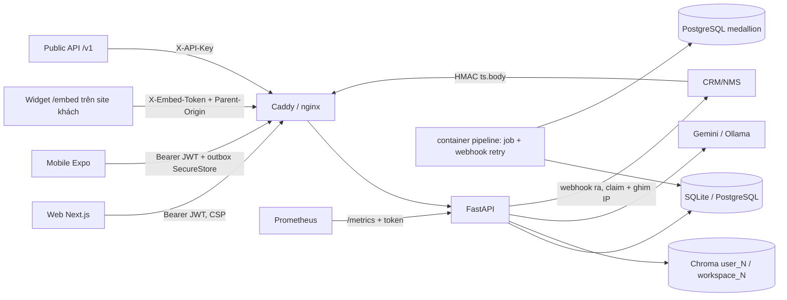

# Báo cáo kiểm toán mã nguồn kỹ thuật — FieldOps (`D:\self`)

- **Ngày kiểm toán:** 2026-11-16 đến 17, bốn vòng:
  - vòng 1 và 2 commit trong `7f0955a`;
  - vòng 3 commit trong `845aec1`;
  - vòng 4 đóng các hạn chế còn lại (§3.5).
- **Nhánh:** `fullstack/fieldops-production`.
- **Mốc mã nguồn:** gốc `7569b27`, sau đó các vòng sửa: `7f0955a` (vòng 1 và 2), rồi commit vòng 3.
- **Thay thế:** báo cáo ngày 2026-11-13. Báo cáo đó không chạy được backend vì môi trường thiếu thư viện.

**Báo cáo chi tiết theo hệ thống:** [`he-thong/`](he-thong/README.md), gồm 7 tệp.

| # | Hệ thống |
|---|---|
| 1 | Xác thực, tài khoản, billing |
| 2 | Vận hành hiện trường |
| 3 | RAG và AI |
| 4 | Pipeline dữ liệu |
| 5 | Triển khai, giám sát, CI |
| 6 | Web |
| 7 | Mobile |

Báo cáo này là bản tổng hợp, mô tả mã nguồn **sau khi đã sửa**.

---

## 1. Phạm vi và độ tin cậy

### Đã làm

**Vòng 1**

1. Lập bản đồ stack và các entry point; đo baseline cho mọi bộ test.
2. Bốn reviewer chạy song song theo vùng rủi ro:
   - xác thực và billing;
   - multi-tenancy;
   - RAG/LLM;
   - pipeline, triển khai và client.
3. Tự đối chiếu từng phát hiện với code.
4. Sửa 20 lỗi có kịch bản lỗi cụ thể (F1–F20).

**Vòng 2**

Chủ dự án yêu cầu "sửa luôn các lỗi". Vòng này sửa tiếp:

- các lỗi đã xác nhận ở vòng 1 nhưng để lại (U1–U19);
- 5 hành vi trước đây được giữ cho chủ dự án quyết định (D1, D2, D3, D6, D7).

D4 và D5 được giữ nguyên có chủ đích; lý do ở §5.

**Quy trình chung cho mọi bản sửa**

- Mỗi bản sửa backend có regression test chạy trên bản `git archive HEAD` sạch: test **FAIL** đúng ở lỗi được mô tả, rồi **PASS** sau khi sửa.
- Client (web và mobile) được kiểm theo cùng quy trình bằng `node --test`.

### Không làm hoặc không kiểm chứng được (giới hạn môi trường)

- **PostgreSQL:** 12 test PostgreSQL bị skip vì không có `FIELDOPS_TEST_POSTGRES_URL` và Docker daemon không chạy. CI có service Postgres và sẽ chạy chúng.
- **Không chạy thật:** Caddy, promtool, thiết bị mobile thật, và các provider bên ngoài (Gemini, Cohere, Stripe, Google, SMTP).
- **Chặn bởi Windows Application Control:** thư viện `xxhash` bị chặn trên Windows, nên backend được chạy trên WSL Ubuntu.

### Độ tin cậy

| Phạm vi | Mức tin cậy |
|---|---|
| Logic backend có test | **Cao** |
| Web và mobile | **Trung bình–cao** (có test mô phỏng và kiểm tra trên trình duyệt; chưa chạy trên thiết bị) |
| Cấu hình triển khai | **Trung bình** (`docker compose config`, `bash -n`; chưa khởi động container) |
| Hành vi provider bên ngoài | **Thấp** (không được thực thi) |

### Ghi chú về môi trường

Commit `7569b27` của một phiên làm việc khác được đẩy lên giữa đợt kiểm toán. Baseline đã được đo lại trên commit này, và mọi thay đổi nằm chồng lên nó.

---

## 2. Kiến trúc

| Hệ thống | Mã nguồn chính | Báo cáo chi tiết |
|---|---|---|
| Xác thực, billing, cổng truy cập | `auth/`, `dependencies.py`, `billing/`, `embed/`, `public_api/`, `admin/`, `config.py` | [he-thong/01](he-thong/01_Xac_thuc_Tai_khoan_Billing.md) |
| Vận hành hiện trường | `field/` | [he-thong/02](he-thong/02_Van_hanh_Hien_truong.md) |
| RAG và AI | `rag/`, `chat/`, `docs/`, `costs/`, `saas/limits.py`, `evals/` | [he-thong/03](he-thong/03_RAG_AI_Tro_ly.md) |
| Pipeline dữ liệu | `pipeline/`, `validation/`, `airflow/` | [he-thong/04](he-thong/04_Pipeline_Du_lieu.md) |
| Triển khai, giám sát, CI | `deploy/`, `monitoring/`, `.github/`, `render.yaml`, `railway.toml`, `metrics.py` | [he-thong/05](he-thong/05_Trien_khai_Giam_sat_CI.md) |
| Web | `frontend/` | [he-thong/06](he-thong/06_Web_Frontend.md) |
| Mobile | `mobile/` | [he-thong/07](he-thong/07_Ung_dung_Mobile.md) |

---

## 3. Lỗi đã sửa

Kịch bản lỗi chi tiết và tên test của từng lỗi nằm trong báo cáo của hệ thống tương ứng. Cột "Test":

- `R1`: `tests/test_audit_regressions.py`;
- `R2`: `tests/test_audit_regressions_round2.py`;
- `CS`: `tests/client_state.test.cjs`.

### 3.1 Mức Cao

| ID | Hệ thống | Vị trí | Lỗi | Test |
|---|---|---|---|---|
| F1 | 5 | `deploy/cloud/Caddyfile` | `X-Frame-Options: SAMEORIGIN` toàn site làm widget nhúng trả phí trắng trơn trên website khách. | Đọc cấu hình |
| F2 | 5 | `.github/workflows/ci.yml` | Bước `docker compose config` luôn đỏ trên checkout sạch (thiếu `deploy/production/.env`). | Tái hiện trên bản archive (exit 1 → 0) |
| D1 | 1 | `auth/service.py:login_with_google` | Pre-hijack: Google gộp vào một tài khoản mật khẩu chưa xác minh, nhưng mật khẩu và JWT của người đăng ký trước vẫn dùng được. | R2, và `test_auth_providers.py` đã cập nhật |
| U1 | 7 | `mobile/lib/offlineOrigin.ts`, `fieldOffline.ts`, `api.ts` | Bản cài mới đổi sang máy chủ thật thì mất vĩnh viễn chế độ offline (bị khoá vào IP dev mặc định). | CS |

### 3.2 Mức Trung bình

| ID | Hệ thống | Vị trí | Lỗi | Test |
|---|---|---|---|---|
| F3 | 1 | `billing/router.py` | Checkout đồng thời tạo hai customer Stripe, nên gói không được nâng sau khi trả tiền. | R1 |
| F4 | 1 | `auth/service.py:register_user` | Email chỉ khác hoa/thường tạo ra hai tài khoản. | R1 |
| — | 1 | `authenticate_user`, `field/router.py:add_member` | Không đăng nhập hay mời vào đội được với email lưu dạng chữ hoa. | R2 |
| U2 | 1 | `embed/router.py:_check_origin` | `allowed_origins` làm widget luôn bị 403. | R2 |
| D2 | 2 | `field/router.py`, `field/dispatch.py` | Kỹ thuật viên gán lại ca hay sửa dispatch của người khác. | R2 |
| F9 | 2 | `field/photos.py` | Ảnh từ 1× đến 2× giới hạn pixel bị giải nén hoàn toàn (tốn RAM). | R1 |
| F10, U5 | 2 | `field/integrations.py` | SSRF qua 100.64/10 và qua DNS rebinding. | R1, R2 |
| U4 | 2 | `field/integrations.py:dispatch_due` | Webhook ra bị gửi trùng giữa hai tiến trình. | R2 |
| F5, F6, F7 | 3 | `docs/router.py`, `chat/schemas.py`, `rag/prompt.py` | Chi phí AI không giới hạn: gợi ý câu hỏi không chịu ngân sách, câu hỏi không giới hạn độ dài, lịch sử không giới hạn; nhãn trích dẫn cũ bị tái sử dụng. | R1 |
| F8 | 3 | `rag/evidence.py` | Tài liệu giả được khối bằng chứng `【E#】`. | R1 |
| D3 | 3 | `rag/chain.py` | Nhãn trích dẫn bịa được stream tới người dùng. | R2 |
| D6 | 6, 7 | `frontend/lib/offlineQueue.ts`, `mobile/lib/fieldOffline.ts` | Một thao tác lỗi 5xx vĩnh viễn chặn mọi thao tác phía sau. | CS (2 test) |
| D7 | 5 | `render.yaml`, `railway.toml` | Deploy PaaS chạy ở chế độ dev, `/metrics` mở công khai. | R2 |
| U16 | 6 | `frontend/next.config.js` | Không có CSP trong khi token nằm ở `localStorage`. | `curl` và trình duyệt |
| F18 | 4 | `pipeline/gold.py`, `medallion.py` | Gold giữ dữ liệu cũ sau một lần nạp lại không đạt kiểm tra. | R1 |

### 3.3 Mức Thấp hoặc Thấp–Trung bình

| ID | Hệ thống | Lỗi | Test |
|---|---|---|---|
| F11 | 1, 2 | Người bị vô hiệu hoá vẫn là `default_assignee` của tích hợp. | R1 |
| F12–F14 | 2 | Lỗi 500 do null hay tz quá biên; khung giờ đảo ngược; ca đã đóng vẫn được xếp lịch. | R1 |
| F15–F17 | 3 | Judge chấm câu từ chối; ghi thiếu usage khi stream bị ngắt (Gemini, Ollama). | R1 |
| F19 | 4 | Số chunk silver đếm cả dòng trùng. | R1 |
| F20 | 6 | Mock của test client thiếu `CasePhotosSection`. | CS (13 → 14/14) |
| U6 | 2 | Quota ảnh kiểu check-then-act. | R2 |
| U7 | 3 | Upload không chịu ngân sách AI. | R2 |
| U8 | 4 | Job runner: lượt chạy kẹt `running`, DB lỗi làm chết scheduler, chạy bù không kích hoạt, khoá chỉ trong một tiến trình. | R2 (một phần kiểm bằng đọc code) |
| U9 | 2, 5 | Alert dead-letter không kích hoạt. | R2 |
| U10 | 2 | Idempotency bỏ qua `step_id`; race 500; đọc body trước khi kiểm kích thước; race tạo ca. | R2 (race tạo ca kiểm bằng đọc code) |
| U11 | 2, 4 | Retry delivery đã giao; bucket theo ngày dùng múi giờ session PostgreSQL. | R2 |
| U12 | 1 | Forgot-password lộ email tồn tại qua thời gian phản hồi; limiter theo email chặn được email của người khác. | R2 |
| U13 | 1 | Vô hiệu hoá tài khoản không huỷ subscription Stripe. | R2 |
| U14 | 3 | Grader: phủ định, từ chối kèm trích dẫn, judge thiếu clamp, `k`. | R2 |
| U15 | 4 | Ingest hằng ngày exit 0 khi mọi tệp lỗi; ngày lệch UTC; đường dẫn và retry của DAG. | R2 |
| U16b | 1, 6 | `/embed?api=` gửi câu hỏi tới máy chủ tuỳ ý. | Trình duyệt |
| U17 | 3 | Nhãn sai định dạng bị báo `uncited` thay vì `invalid`. | R2 |
| U18 | 5, 7 | Caddy sập khi `ACME_EMAIL` rỗng; mobile đọc dữ liệu ngoài storage lock. | R2, và đọc code |
| U19 | 1 | `ALGORITHM` và tham số chunk không được kiểm lúc khởi động. | R2 |

U3 ("stream trước khi audit") được giải quyết bằng D3.

---

### 3.4 Vòng 3: xử lý dứt điểm năm hạn chế còn lại

Chủ dự án yêu cầu xử lý năm hạn chế mà vòng 2 mới chỉ giảm thiểu. Test: `R3` là `tests/test_audit_regressions_round3.py`, `CS` là `tests/client_state.test.cjs`.

| ID | Hệ thống | Trước | Sau | Test |
|---|---|---|---|---|
| V1 | 3 | Ngân sách AI chỉ so với chi phí đã ghi, nên N request đồng thời cùng vượt trần | **Trần cứng theo đặt chỗ.** Bảng `llm_budget_reservations`; mỗi request đặt trước `LLM_BUDGET_RESERVE_USD` (mặc định ≈ chi phí 16k token vào + 2k token ra). Điều kiện chấp nhận "đã chi + đặt chỗ ≤ trần" được kiểm trong giao dịch có khoá (SQLite: khoá ghi; PostgreSQL: `pg_advisory_xact_lock`). Request kết thúc thì trả đặt chỗ; tiến trình chết thì đặt chỗ tự hết hạn sau 15 phút | R3 (3 test) |
| V2 | 1, 6 | JWT nằm trong `localStorage`; CSP phải mở `'unsafe-inline'` cho script | **Cookie httpOnly cùng CSRF.** Web gửi `X-Auth-Mode: cookie`, server đặt cookie `fieldops_session` (httpOnly, SameSite=Lax, Secure ngoài môi trường dev) và **không trả token trong body**. Mọi request ghi dùng cookie phải có `X-Requested-With: fieldops`. Có `/auth/logout` xoá cookie và `/auth/session` đổi token cũ trong localStorage sang cookie một lần. Mobile và API giữ Bearer. **CSP có nonce** (`proxy.ts`): `script-src 'nonce-…' 'strict-dynamic'`, không còn `'unsafe-inline'`; mọi trang render theo từng request | R3 (4 test), CS (2 test), trình duyệt |
| V3 | 3 | Quy tắc trả lời nằm chung chuỗi với tài liệu | `RagPrompt` mang `.system`: Gemini nhận qua `system_instruction`, Ollama qua trường `system`. Nội dung tài liệu không còn đứng cùng cấp với quy tắc | R3 (2 test); eval offline giống hệt |
| V4 | 7 | Máy đã bị bản cũ khoá vào IP dev thì mất chế độ offline | `releaseUnusedLegacyBinding`: gỡ ràng buộc khi nó đến từ bản cũ (không có marker) **và** người dùng hiện tại không có bản ghi offline nào | CS |
| V5 | 2 | `create_step` dùng `len(case.steps)`, nên tạo đồng thời bị trùng vị trí | `UPDATE` không đổi gì trên dòng ca (lấy khoá), rồi `MAX(position) + 1` | R3 |

---

### 3.5 Vòng 4 (17/11/2026): đóng các hạn chế còn lại của §4

Test: `R4` là `tests/test_audit_regressions_round4.py`, `EP` là `tests/test_edge_config_parity.py`, `CS` là `tests/client_state.test.cjs`. Các test mới FAIL trên `845aec1` (8 test backend và 1 test client); 2 test trong EP là chốt chặn cho bản sửa F1 và nhánh SSE, nên PASS trên cả hai bản.

| ID | Trước | Sau | Test |
|---|---|---|---|
| W1 | Một request có thể tiêu nhiều hơn khoản đặt trước, vì đầu ra không có trần, Cohere không được tính, upload đặt trước như một câu hỏi, và judge chạy nền không chịu ngân sách | `LLM_MAX_OUTPUT_TOKENS` (mặc định 4096, gồm cả token thinking) áp cho mọi lời gọi; prompt vượt `LLM_MAX_INPUT_TOKENS` (16.000) bị từ chối trước khi gọi API; khoản đặt trước mặc định = chi phí tối đa (vào + ra), cộng một lượt Cohere khi được bật; upload đặt trước theo kích thước tệp; judge xin khoản riêng và bỏ qua khi hết ngân sách | R4 (6 test) |
| W2 | Sau khi gỡ ràng buộc offline cũ, dữ liệu của **người dùng khác** từ máy chủ cũ có thể bị một tài khoản trùng ID trên máy chủ mới đọc | Manifest mới ghi `origin`. Bản ghi không có origin (của bản cũ) chỉ hiển thị ở máy chủ cũ đã được ghi nhận lúc gỡ ràng buộc; ghi đè hay xoá không chạm vào bản ghi của máy chủ khác | CS |
| W3 | Hai cấu hình biên viết tay lệch nhau: nginx gửi `Permissions-Policy: geolocation=()`, **chặn nút "lấy vị trí hiện tại"** của màn điều phối; Caddy không gửi Permissions-Policy | Cả hai gửi `camera=(self), geolocation=(self)`; test so khớp các header nền, chính sách khung `/embed` và việc tắt buffer SSE giữa hai cấu hình | EP (4 test) |

---

## 4. Hạn chế còn lại (sau vòng 4)

| Vấn đề | Vì sao không sửa trong code | Cần ai làm |
|---|---|---|
| Eval **live** sau khi tách system prompt chưa chạy | Cần `GEMINI_API_KEY` trong `.env` cục bộ; kiểm toán không đọc file này | Chủ dự án chạy `python -B backend/scripts/run_evals.py --mode live --limit 20` (§9) |
| `style-src` vẫn có `'unsafe-inline'` | Không phải lỗi: thuộc tính `style` trong HTML do SSR sinh ra không mang nonce được, và CSS không thực thi mã. Script đã bị chặn bằng nonce | Không cần |
| `allowed_origins` của embed không chặn được client không phải trình duyệt | Không phải lỗi: embed token vốn là công khai, `allowed_origins` chỉ ngăn website khác nhúng widget | Không cần; đã ghi rõ trong tài liệu |
| Bản ghi offline cũ trùng khoá bị ghi đè khi người dùng trùng ID ghi dữ liệu mới (dữ liệu cũ không lộ nhưng có thể bị thay) | Kiểu khoá của bản cũ không chứa origin; muốn giữ được cả hai thì phải di trú toàn bộ khoá | Chấp nhận (trường hợp biên của trường hợp biên) |
| Test PostgreSQL, Caddy thật, thiết bị di động, provider thật | Giới hạn môi trường của máy kiểm toán | CI (PostgreSQL, promtool) và kiểm tra sau deploy |

---

## 5. Quyết định giữ nguyên

| ID | Hành vi | Lý do giữ |
|---|---|---|
| D4 | Quota vẫn bị trừ khi provider lỗi (docstring `release_query_quota`) | Chống lạm dụng: request đã vào RAG thì đã tốn tài nguyên |
| D5 | `rag/technical` từ chối khi có hơn 4 parent đạt ngưỡng, thay vì cắt bớt | Câu trả lời kỹ thuật không được bỏ sót bằng chứng bắt buộc |

---

## 6. Vùng đã xác minh là đúng

Các vùng này không cần sửa; chi tiết ở từng báo cáo hệ thống.

- **Xác thực:**
  - JWT ghim thuật toán, kiểm `purpose` và `token_version`.
  - Token đặt lại mật khẩu dùng một lần.
  - Token xác minh email gắn hash của email.
  - Xác minh Google qua JWKS, `aud`, `iss` và `email_verified`.
- **Phân quyền và quota:**
  - API key phạm vi theo user; admin đọc role từ DB.
  - Không có IDOR giữa các workspace.
  - Quota cập nhật nguyên tử.
  - Migration có khoá và chạy lại được nhiều lần.
- **RAG:**
  - RRF với hạng tính từ 1.
  - Cô lập collection; cache khoá theo revision.
  - Vòng đời publish và recovery.
- **Triển khai:**
  - Compose production: chỉ gateway publish cổng; các mạng dữ liệu là `internal`.
  - Secret qua `_FILE`.
  - Shell script dùng `set -euo pipefail`.
  - Pipeline SQL có tham số bind.

---

## 7. Kết quả kiểm thử trước và sau khi sửa

Môi trường:

- **Backend:** WSL Ubuntu, Python 3.12.3, venv cài từ `backend/requirements.txt`, chạy trên bản sao đã loại `.env` cục bộ.
- **Web và mobile:** Windows, Node 25.2.1, `npm ci` sạch.

| Bộ kiểm tra | Trước (HEAD `7569b27`) | Sau vòng 1 | Sau vòng 2 | **Sau vòng 3** | Ghi chú |
|---|---|---|---|---|---|
| `check_dependencies.py` | PASS | PASS | PASS | PASS | 29 gói, 18 import contract |
| Backend pytest | 468 passed, 12 skipped | 484 / 12 | 517 / 12 | **527 passed, 12 skipped** | Không có hồi quy. 12 skip là test PostgreSQL (môi trường) |
| Regression test trên mã trước vòng | — | 16/16 FAIL | 31/32 FAIL | **10/10 FAIL** (so với `7f0955a`) | Ở vòng 2, test còn lại là test chống hồi quy |
| `node --test tests/client_state.test.cjs` | 13/14 | 14/14 | 17/17 | **19/19** | 3 test vòng 3 FAIL trên `7f0955a` |
| Frontend typecheck và build | PASS | PASS | PASS | **PASS**; mọi trang render theo từng request; nhận diện Proxy | |
| Mobile `tsc` | PASS | PASS | PASS | **PASS** | |
| Eval offline: `run_evals` (68 câu) | pass 0,7206; recall@5 1,0; MRR 0,9121 | giống | giống | **giống hệt** | Đổi grader và tách system prompt không đổi kết quả offline |
| `run_eval_benchmark`, `validate-only` | PASS | PASS | PASS | PASS | |
| `docker compose config` (root) | **FAIL** | PASS sau bootstrap | PASS | PASS | F2 |
| Trình duyệt, end-to-end (API WSL + `next start`, DB tạm) | — | — | Trang render; CSP chặn domain lạ | Xem dưới | |

**Sau vòng 4:**
- Backend: **537 passed, 12 skipped** (thêm 6 test R4 và 4 test EP, không có hồi quy).
- `client_state`: **20/20**.
- Mobile `tsc`: PASS.

Kiểm tra end-to-end sau vòng 3:

- Đăng ký và đăng nhập rồi vào `/chat`. `localStorage` chỉ còn `rag_user` và `rag_session`; `document.cookie` rỗng (cookie là httpOnly).
- Reload vẫn giữ phiên. POST tạo hội thoại qua cookie và header CSRF thành công.
- Đăng xuất làm `/auth/me` trả 401.
- Token cũ trong `localStorage` được tự đổi sang cookie, và người dùng ở lại trong app. Lần chạy đầu phát hiện một race (AuthProvider mount hai lần) và đã sửa.
- HTML chèn vào trang (``, `<iframe srcdoc><script>`) **bị CSP chặn**.

---

## 8. Refactoring và mã chết

Đợt kiểm toán ưu tiên thay đổi tối thiểu. Không đổi schema DB và không đổi API, trừ các điểm sau:

- giới hạn 4000 ký tự cho câu hỏi chat;
- `PATCH /field/cases/{id}/dispatch` chỉ dành cho owner;
- `/embed/chat` nhận thêm header `X-Embed-Parent-Origin`;
- retry một delivery đã giao trả 409;
- inbound webhook trả 503 khi race.

### Hàm mới

| Hàm | Vị trí | Tác dụng |
|---|---|---|
| `find_active_user_by_email` | `auth/service.py` | Tìm tài khoản theo email không phân biệt hoa/thường |
| `cancel_customer_subscriptions` | `billing/router.py` | Huỷ subscription Stripe khi vô hiệu hoá tài khoản |
| `utc_date` | `database.py` | Bucket ngày theo UTC trên PostgreSQL |
| `_post_pinned` | `field/integrations.py` | Gửi webhook tới đúng IP đã kiểm tra |
| `_require_case_edit_rights` | `field/router.py` | Phân quyền sửa ca |
| `fail_interrupted_runs`, `_chain_lock`, `_safe_chain` | `pipeline/jobs/runner.py` | Dọn lượt chạy kẹt, khoá chuỗi job, giữ vòng lặp lịch |
| `bindOfflineApiOriginForWrite` | `mobile/lib/offlineOrigin.ts` | Chỉ gắn origin khi ghi dữ liệu offline |
| `_safe_release_point` | `rag/chain.py` | Giữ nhãn trích dẫn lại cho tới khi kiểm tra xong |

### Mã chết và tồn đọng (không xoá)

- `backend/api/` và `backend/platform/`: thư mục rỗng, không được git theo dõi.
- `backend/_uvicorn*.log`: log cục bộ, đã gitignore.
- `prompt.format_context`: vẫn dùng khi `include_evidence=False`.
- `deploy/production/edu` và `deploy/production/telecom`: hai dự án khác đóng gói chung.

---

## 9. Lộ trình

| Giai đoạn | Việc | Ưu tiên |
|---|---|---|
| Ngay | Xem kết quả CI trên nhánh đã push (gồm 12 test PostgreSQL và promtool) | Cao |
| Ngay | Chạy eval live (cần `GEMINI_API_KEY` trong `.env`): `cd backend` rồi `python -B scripts/run_evals.py --mode live --limit 20`. Khoảng 20 câu Gemini, chi phí vài cent | Cao |
| Ngay | Sau deploy: kiểm header `/embed` và `/` bằng `curl -I`; đăng nhập web lại (phiên cũ tự chuyển sang cookie) | Cao |
| Ngay | Đặt `EXPO_PUBLIC_API_URL` cho bản mobile phát hành | Cao |
| Triển khai | API và web khác site (khác tên miền gốc): đặt `AUTH_COOKIE_SAMESITE=none` (tự bật Secure) và cấu hình `CORS_ORIGINS` | TB |
| 1 | Điều chỉnh `LLM_MAX_OUTPUT_TOKENS` / `LLM_MAX_INPUT_TOKENS` theo câu trả lời dài nhất cần hỗ trợ (khoản đặt trước tự tính theo hai giá trị này) | Thấp |
| 2 | Nếu thêm header mới ở một biên (Caddy/nginx), thêm luôn vào `tests/test_edge_config_parity.py` | Thấp |
| 3 | Tách RAG/embedding ra worker; tách `deploy/production` đa dự án | Thấp |

---

## 10. Danh sách tệp thay đổi

Toàn bộ chưa commit.

**Backend (28 tệp)**

- `auth/`: `lifecycle.py`, `router.py`, `service.py`
- `billing/router.py`
- `chat/`: `router.py`, `schemas.py`
- `config.py`, `database.py`, `metrics.py`
- `costs/router.py`
- `analytics/service.py`
- `docs/router.py`
- `embed/router.py`
- `evals/`: `graders.py`, `harness.py`
- `field/`: `dispatch.py`, `integrations.py`, `photos.py`, `router.py`
- `pipeline/`: `gold.py`, `medallion.py`, `silver.py`, `jobs/daily_ingest.py`, `jobs/runner.py`
- `rag/`: `chain.py`, `evidence.py`, `llm.py`, `prompt.py`

**Frontend (5 tệp)**

- `app/(app)/field/page.tsx`
- `app/embed/page.tsx`
- `components/ChatWindow.tsx`
- `lib/offlineQueue.ts`
- `next.config.js`

**Mobile (4 tệp)**

- `lib/api.ts`
- `lib/fieldOffline.ts`
- `lib/offlineOrigin.ts`
- `screens/ChatScreen.tsx`

**Triển khai, giám sát, CI (8 tệp)**

- `.github/workflows/ci.yml`
- `deploy/cloud/Caddyfile`
- `deploy/cloud/deploy.sh`
- `deploy/cloud/docker-compose.yml`
- `render.yaml`
- `railway.toml`
- `monitoring/alerts/fieldops-rules.yml`
- `airflow/dags/daily_rag_ingest.py`

**Test**

- `tests/client_state.test.cjs`
- `tests/test_auth_providers.py`
- `tests/test_audit_regressions.py` (mới)
- `tests/test_audit_regressions_round2.py` (mới)

**Vòng 3**

- Backend:
  - `costs/budget.py`, `costs/models.py` (bảng `llm_budget_reservations`)
  - `auth/session_cookie.py` (mới), `auth/router.py`, `dependencies.py`, `config.py`
  - `rag/prompt.py`, `rag/llm.py`
  - `field/router.py`
  - các điểm gọi ngân sách: `chat/router.py`, `embed/router.py`, `docs/router.py`, `public_api/router.py`
- Frontend:
  - `proxy.ts` (mới), `next.config.js`, `app/layout.tsx`
  - `lib/api.ts`, `lib/auth.tsx`
  - `app/(auth)/login/page.tsx`, `app/(auth)/register/page.tsx`
  - `components/GoogleSignInButton.tsx`, `components/UploadZone.tsx`
  - `app/(app)/field/page.tsx`
- Mobile: `lib/offlineOrigin.ts`, `lib/fieldOffline.ts`
- Test:
  - `tests/test_audit_regressions_round3.py` (mới)
  - `tests/client_state.test.cjs`
  - `tests/test_cost_tracking.py`: đặt `LLM_BUDGET_RESERVE_USD` để giữ đúng ý nghĩa test ngưỡng dưới trần cứng

**Báo cáo**

- `reports/01_*.md`, `reports/02_*.md`
- `reports/he-thong/` (mới, 8 tệp)
