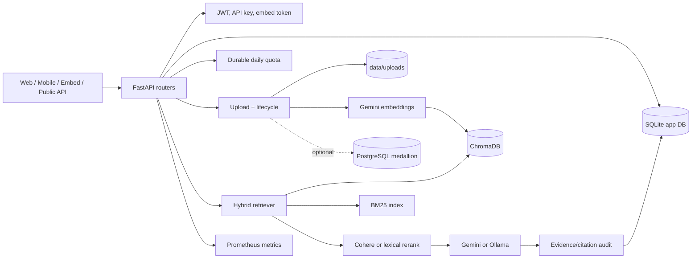

# Technical Code Audit & Refactoring Report

**Audit basis:** repository state inspected on 2026-11-13. Existing uncommitted changes were treated as user-owned. No unrelated files were reverted or deleted.

## 1. Executive summary

FieldOps is a multi-client field-service platform. The web and mobile clients call a FastAPI backend for authentication, workspaces, service cases, documents, conversations, billing, analytics, and a grounded RAG assistant. SQLite is the default application store; ChromaDB stores vectors; PostgreSQL is an optional medallion warehouse; Redis and Cohere are optional accelerators.

The codebase has substantial real implementations and a broad regression suite. Frontend type-check and production build both passed. Backend tests did not reach assertions because the selected `backend/.venv` is missing declared packages (`jwt`/PyJWT and `redis`). Therefore the backend status is **NOT RUN/BLOCKED**, not PASS.

One source change was made: optional medallion startup failures remain non-fatal for SQLite development, but are now logged with the exception type. This removes an observability blind spot without changing the API contract or data behavior.

## 2. Project structure and entry points

| Area | Responsibility | Evidence |
|---|---|---|
| `backend/main.py` | FastAPI construction, lifespan, router registration, health and metrics | `lifespan`, `app`, `include_router` |
| `backend/auth/` | JWT authentication, bcrypt passwords, reset-token lifecycle | `auth.service`, `auth.router` |
| `backend/chat/` | Conversation/message persistence and streaming chat | `chat.router`, `chat.service` |
| `backend/field/` | Workspace, membership, case/checklist/event workflows | `field.router`, `field.models` |
| `backend/docs/` | Upload, list, lineage, delete and workspace ownership checks | `docs.router.upload_doc` |
| `backend/rag/` | Loading, chunking, embedding, hybrid retrieval, reranking, grounding and evidence | `ingest`, `retriever`, `chain`, `evidence` |
| `backend/pipeline/` | Optional Bronze/Silver/Gold PostgreSQL path and lineage | `pipeline.db`, `pipeline.*` |
| `frontend/` | Next.js web console and embedded widget | App Router pages and `lib/api.ts` |
| `mobile/` | React Native/Expo field client with offline queue | `lib/fieldOffline.ts`, screens |
| `tests/` | Backend security, RAG, workflow, migration and client-state regression tests | 296 collected before import errors |
| `deploy/`, `airflow/`, `monitoring/`, `gx/` | Production packaging, ingestion orchestration, metrics and data quality | deployment and operational assets |

Primary backend command is `uvicorn main:app` through `backend/start.ps1`/container configuration. Frontend commands are `npm run dev`, `npm run typecheck`, `npm run build`.

## 3. System architecture and request flow

For a normal chat request: authentication is resolved in `backend/dependencies.py:get_current_user`; conversation ownership is checked in `backend/chat/service.py`; quota is atomically reserved in `backend/saas/limits.py:enforce_query_quota`; `backend/rag/retriever.py:retrieve` reads a revision-consistent snapshot, runs vector and BM25 retrieval, fuses results, and reranks; `backend/rag/chain.py:stream_rag_answer` generates on a bounded worker slot; citation evidence is validated before the assistant message is committed by `backend/chat/router.py:chat_stream`.

## 4. Current implementation status

| Capability | Status | Evidence / qualification |
|---|---|---|
| Registration/login/JWT revocation | Implemented | bcrypt, typed JWT claims, token version checks |
| Workspace and service-case workflow | Implemented | routers/models/tests present; requires runtime verification |
| Document upload and path containment | Implemented | extension, size, ownership and resolved-path checks |
| Text/PDF/DOCX/image ingestion | Implemented | loaders, OCR adapter, chunking, embedding and lifecycle recovery |
| Hybrid RAG | Implemented | Chroma + BM25 + RRF + rerank fallback |
| Grounded evidence | Implemented | evidence bundle and citation audit are persisted/exposed |
| Web UI | Implemented | build and typecheck PASS |
| Mobile offline queue | Implemented in client code | needs device/network integration verification |
| PostgreSQL medallion | Partial/optional | startup deliberately continues when warehouse unavailable |
| Redis cache/Cohere rerank/Stripe/email | Optional integration | enabled only when corresponding configuration is present |
| CRM/NMS synchronization, route scheduling, field photos | Not implemented | explicitly listed as future scope in README |

## 5. Module analysis and findings

### High priority

1. **Backend environment drift — High / operational.** `backend/requirements.txt` declares PyJWT and redis, and `backend/scripts/check_dependencies.py` explicitly checks them, but the selected virtual environment lacks both and has multiple version mismatches (including FastAPI, Starlette, Pydantic, SQLAlchemy, pypdf, pandas and Stripe). Consequence: test collection and application imports fail before behavior is exercised. Remedy: install from the pinned requirements in a clean environment and make CI/environment bootstrap mandatory before local verification.

2. **Warehouse failure visibility — High / fixed in this audit.** `backend/main.py:35` previously swallowed all exceptions from `init_medallion_schema`. The code still starts in SQLite-only mode, but now emits a warning containing the exception type. A production deployment should additionally expose warehouse readiness separately from `/health`.

3. **Production readiness is configuration-dependent — High / remaining.** `validate_security_config` protects production JWT signing, but external services, CORS, Stripe, email, PostgreSQL and Redis are optional by design. A deployment health check must distinguish “feature disabled” from “feature configured but unavailable.”

### Medium priority

4. **Startup work is synchronous around database/schema setup — Medium.** `init_db` and medallion initialization run during the async lifespan. This is acceptable for a small deployment but can lengthen readiness. Move heavy migrations to a deployment job once multi-worker production operation is required.

5. **RAG dependencies are provider-heavy — Medium.** Importing the application imports Google/LangChain/Chroma paths. A minimal auth-only deployment still needs the full RAG dependency set. Consider optional provider modules or a separate worker if cold-start and memory become constraints.

6. **Frontend landing page contains intentional mockup visuals — Low, documented.** `frontend/app/page.tsx` labels analytics/audit visuals as mockups. They are presentation content, not evidence of live analytics. Keep the labels and do not count them as runtime functionality.

## 6. Technology and algorithm assessment

- FastAPI provides dependency-injected HTTP routing and SSE responses.
- SQLAlchemy 2 provides ORM/database transactions; migrations are versioned in `backend/schema_migrations.py`.
- JWT (HS256 by default) carries `sub`, `exp`, `purpose`, and token version. Database lookup remains authoritative, so token theft does not bypass revocation.
- bcrypt hashes passwords with a 72-byte input guard.
- LangChain loaders/splitters and Google GenAI provide document processing and embedding/generation; the project owns lifecycle, evidence, quota, and retrieval orchestration.
- Chroma similarity search supplies semantic candidates. BM25 supplies lexical candidates for exact codes and identifiers. Reciprocal Rank Fusion combines independent rankings. Cohere reranking is optional; lexical reranking is the deterministic fallback.
- Redis is a read-through retrieval cache keyed by collection revision and query. The revision key prevents stale results after publication.
- Prometheus middleware exposes request metrics; Grafana assets visualize them.

The main algorithmic risks are external model variability, embedding/model drift, and sparse/low-quality documents. The code mitigates stale publication and invalid citations, but quality still needs an evaluated corpus and provider-specific thresholds.

## 7. Duplicate/dead-code analysis

No file was deleted. The repository contains multiple deployment variants under `deploy/production` and `deploy/distributed`; these are not safe to remove without deployment-manifest and CI verification. `frontend/app/page.tsx` mockups are referenced UI content, not dead code. The backend dependency checker is an active operational guard. A definitive unused-symbol report requires a working type/lint/static-analysis environment and should be a follow-up, not a guess based on filenames.

## 8. Refactoring changes

- Updated `backend/main.py` so optional medallion initialization logs a warning with the exception type instead of silently swallowing every error.
- No API contract, schema, storage path, or user data was changed.
- No uncommitted user changes were reverted.

## 9. Testing and verification

| Check | Result | Evidence |
|---|---|---|
| Frontend TypeScript | PASS | `npm run typecheck` |
| Frontend production build | PASS | `npm run build`; 15 routes generated |
| Backend dependency contract | FAIL/BLOCKED | dependency checker reports missing PyJWT, psycopg2 and redis plus multiple pinned-version mismatches |
| Backend pytest collection | BLOCKED | `ModuleNotFoundError: jwt` and `ModuleNotFoundError: redis` in `backend/.venv` |
| Backend test assertions | NOT RUN | collection stopped after 14 import errors |
| Production integration/LLM calls | NOT RUN | would require external services and secrets |
| Docker/warehouse runtime | NOT RUN | not required for static audit and no readiness evidence collected |

## 10. Remaining issues

- Recreate/install the backend environment from `backend/requirements.txt` and rerun all tests.
- Run PostgreSQL-backed tests with the configured service and verify medallion readiness separately.
- Exercise upload → retrieval → evidence → delete/recovery against a real Chroma store.
- Add CI checks for mobile and backend dependency bootstrap parity (mobile typecheck exists; local mobile run was not performed).
- Replace placeholder deployment URLs and review production secrets/TLS outside source control.

## 11. Roadmap

| Phase | Work | Priority | Complexity |
|---|---|---|---|
| 1 — Foundation | Rebuild backend env, run 296-test suite, fix all assertion failures | Critical | M |
| 1 — Foundation | Add `/ready` dependency-aware readiness and structured startup logging | High | S |
| 1 — Foundation | Verify migrations and document lifecycle on SQLite and PostgreSQL | High | M |
| 2 — Scale | Separate heavy RAG/embedding work from API workers; measure latency and memory | Medium | L |
| 2 — Scale | Add retrieval-quality corpus, regression thresholds, and provider drift monitoring | High | M |
| 2 — Scale | Complete mobile/network integration and offline conflict telemetry | Medium | M |
| 3 — Production | CI security/dependency audit, backups, restore drills, alerting and runbooks | High | L |
| 3 — Production | Pilot CRM/NMS integration, scheduling and field-photo retention policy | Low | L |

## 12. Final assessment

The project is a substantial working implementation, not merely a UI mockup. Web compilation is healthy, and the backend has real security, persistence, lifecycle, quota, retrieval and evidence logic. It is **not yet certified production-ready by this audit** because backend verification is blocked by environment drift and external integrations were not exercised. The five most important next actions are: install the declared backend dependencies; rerun/fix the full backend suite; add dependency-aware readiness; verify both database modes and document recovery; establish repeatable RAG quality and operational monitoring gates.
