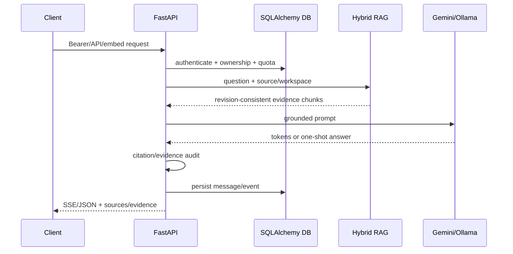

# Deep Technical Explanation & Project Knowledge Report

## 1. Bài toán dự án giải quyết

FieldOps (nền tảng điều hành dịch vụ hiện trường) nối ba nhu cầu: quản lý đội/workspace, quản lý ca sửa và tra cứu SOP/manual bằng trợ lý AI có dẫn chứng. Người dùng không hỏi một mô hình “biết mọi thứ”; trợ lý chỉ nên trả lời từ tài liệu đã nạp, trong khi kỹ thuật viên vẫn chịu trách nhiệm xác nhận thao tác.

Web console phục vụ điều phối và quản trị. Ứng dụng mobile phục vụ kỹ thuật viên và có hàng đợi offline cho một số thao tác ca. Backend là nơi giữ quyền sở hữu dữ liệu, phân quyền, quota, lịch sử và bằng chứng.

## 2. Hệ thống hoạt động tổng thể

Application startup is defined in `backend/main.py:lifespan`: validate production security configuration, create data directories, initialize the app schema and recover interrupted document publications. The optional medallion schema is attempted but does not prevent SQLite-only startup; after this audit it emits a warning when initialization fails.

## 3. Request and data lifecycles

### Authentication

`backend/auth/service.py` hashes passwords with bcrypt and creates JWTs containing `sub`, `exp`, `purpose`, and a database-backed token `version`. `backend/dependencies.py:get_current_user` decodes and validates the token, then queries a non-deleted user whose `token_version` matches. Password reset increments the version, invalidating old access tokens. Thus JWT is a transport credential, while the database is the revocation authority.

### Document upload

`backend/docs/router.py:upload_doc` verifies workspace membership/ownership, sanitizes the filename, checks the extension and a 20 MB default limit, reads at most one byte beyond the limit, and passes the bytes to `backend/rag/ingest.py`. The ingestion pipeline loads PDF/DOCX/TXT or OCRs supported images, attaches source metadata, splits documents with a recursive splitter, embeds chunks, and publishes them into a Chroma collection. The document lifecycle module coordinates publication, revision markers, locks and recovery. Delete invalidates BM25/cache state and removes the published document through the lifecycle path.

### Chat

`backend/chat/router.py:chat_stream` checks the conversation belongs to the user, atomically reserves one daily query, stores the user message, snapshots history, and starts an SSE generator. `backend/rag/chain.py:stream_rag_answer` retrieves chunks, builds an evidence context, calls the provider on a bounded worker slot, validates citations, then emits `done`. Only after completion does the route persist the assistant message and structured evidence. Provider errors return a safe public error message rather than provider internals.

Public API and embed routes reuse the same quota and RAG concepts with different credentials. Field assistance additionally writes an assistant recommendation event tied to the service case.

## 4. Retrieval and ranking in detail

The retriever takes `RETRIEVE_CANDIDATES` candidates (default 15) and returns `TOP_K` results (default 5). Two branches run concurrently:

1. Chroma performs semantic similarity search using the configured embedding model.
2. BM25 searches the same collection lexically, which is useful for exact alarm codes, model names and identifiers.
3. Results are merged with Reciprocal Rank Fusion (RRF).
4. Cohere rerank is used when configured; otherwise `lexical_rerank` scores query/chunk token overlap and gives section headings extra weight.
5. The final list is cached using the collection revision, query, source and workspace scope.

For RRF, if a document has rank (r_i(d)) in result list (i), a common form is:

\[
RRF(d) = \sum_i \frac{1}{k + r_i(d)}
\]

Here (k) is a damping constant and the rank starts at 1. Example: with (k=60), a document ranked 1 in semantic search and 4 in BM25 scores (1/61 + 1/64). A document appearing only at rank 2 scores (1/62). The first document wins because independent evidence from both lists is rewarded. The exact fusion implementation is in `backend/rag/bm25.py:reciprocal_rank_fusion`; the code, rather than this generic formula, is authoritative for its tie and truncation behavior.

Lexical reranking uses token overlap. If a chunk contains two primary query terms in its heading and three in its body, its score contribution is (4×2 + 2×3 = 14), before contextual heading matches. This is intentionally a fallback heuristic, not a learned relevance model. Stopwords are removed and a field-case query after `Câu hỏi kỹ thuật viên:` receives primary weight.

Semantic retrieval itself is delegated to Chroma/LangChain. The project calls the library API; it does not implement the embedding model or cosine/distance kernel. Therefore embedding quality, vector metric and model behavior must be verified against the installed Chroma configuration rather than inferred from the route code.

## 5. Chunking and ingestion assumptions

The recursive splitter defaults to chunk size 1000 and overlap 100. If a document has length (L), a rough upper bound on chunk count for regular text is:

\[
N \approx \left\lceil \frac{L - O}{S - O} \right\rceil
\]

where (S=1000) is chunk size and (O=100) is overlap. For (L=2500), this estimates (\lceil 2400/900\rceil=3) chunks. Real counts differ because the recursive splitter respects separators and may produce smaller chunks. Overlap preserves context at boundaries but increases embedding/storage cost.

OCR is a Gemini-dependent path. Empty OCR output is rejected. Images therefore require Gemini even if text generation is configured for Ollama.

## 6. Quota mathematics and transaction behavior

`backend/saas/limits.py:enforce_query_quota` updates the daily counter conditionally:

\[
used' = used + 1 \quad \text{only if } used < limit
\]

The update is committed before model generation, so concurrent workers cannot both pass the same final slot. A request accepted into RAG remains charged even if the provider later fails; only local preparation failures call `release_query_quota`. This is a deliberate billing/abuse-control decision and is covered by `tests/test_query_quota.py`.

The initialization migration counts retained assistant messages and field recommendation events once per UTC day, guarded by a migration marker. It avoids repeatedly reconstructing usage from mutable history on every restart.

## 7. Technologies and why they are used

- **FastAPI:** async HTTP/SSE and dependency injection; suitable for separate web, mobile, embed and public boundaries.
- **SQLAlchemy:** transactional models and portability between SQLite development and PostgreSQL warehouse/application deployments.
- **SQLite:** low-friction local app store; not a substitute for a tested multi-writer production topology.
- **ChromaDB:** local/persistent vector index for per-user or per-workspace retrieval.
- **BM25:** lexical complement for identifiers and exact operational language.
- **Google GenAI:** embeddings, Gemini generation and image OCR. Ollama is an optional local text-generation provider.
- **Redis:** optional retrieval cache for multi-process deployments; local behavior can operate without it.
- **PostgreSQL + medallion layers:** optional Bronze raw metadata, Silver cleaned chunks and Gold summaries/metrics for data engineering workflows.
- **Next.js/React:** web console with App Router and static/dynamic route rendering.
- **Expo/React Native:** mobile client and secure local storage/offline queue.
- **Prometheus/Grafana:** metrics collection and operational dashboards.

## 8. Important design decisions

1. **Evidence-first answers.** Retrieval chunks are captured before generation and citation validity is checked before the answer is marked complete. This reduces plausible but unsupported responses.
2. **Revision-consistent reads.** Publication locks and revision checks prevent a cache or retrieval result from being written after the underlying collection changed.
3. **Bounded generation concurrency.** A semaphore limits synchronous provider workers, preventing unlimited client streams from exhausting threads.
4. **Defense-in-depth file boundaries.** Filename sanitization plus resolved-parent equality protects user/workspace upload roots.
5. **Stable public failures.** Provider exception details are logged by type but are not returned as raw external-service errors.
6. **Optional integrations.** Redis, Cohere, Stripe, email and the warehouse can be absent for local development. This improves portability but means readiness must expose feature availability clearly.

## 9. Strengths, weaknesses and limits

Strengths include explicit ownership checks, token revocation, transactional quota enforcement, document recovery machinery, hybrid retrieval, evidence bundles, frontend build health and a large regression suite.

Weaknesses are operational: backend dependency drift blocked local test collection; external-provider behavior was not run in this audit; optional warehouse startup can still leave the application serving without medallion functionality; and the project has several deployment variants that increase configuration surface.

RAG limits include embedding drift, OCR errors, incomplete source documents, lexical false positives, provider latency, and the fact that reranking cannot recover a relevant chunk that neither initial retriever finds. Evaluation data and a measured quality threshold are necessary before claiming production accuracy.

## 10. Failure scenarios and diagnosis

- **`ModuleNotFoundError` at import:** rebuild `backend/.venv` from `backend/requirements.txt`; do not interpret this as application test failure.
- **No Gemini key:** Gemini generation/upload paths fail unless `LLM_PROVIDER=ollama` is valid for text generation; OCR/embeddings still need Gemini.
- **Both retrieval branches fail:** the request produces a safe RAG-unavailable response and the accepted quota remains charged.
- **One retrieval branch fails:** the other branch may still serve results; the failure is logged by branch type.
- **Warehouse unavailable:** SQLite application behavior continues, but medallion lineage/stats are unavailable and a startup warning is emitted.
- **Interrupted publication:** startup recovery scans pending transactions and attempts restoration before serving.
- **Invalid citation or stale document revision:** generation is not completed/persisted as a successful grounded answer.
- **Offline mobile mutation:** the queue retries when connectivity returns; conflict semantics and device-level integration still need field testing.

## 11. What is real versus future work

Real code exists for authentication, app persistence, cases/checklists/events, document ingestion, hybrid retrieval, evidence, web UI, mobile queue, analytics, embed/public boundaries and optional billing/warehouse adapters. The README explicitly identifies CRM/NMS sync, route scheduling, field-photo storage and internal-system integration as not yet implemented. Landing-page mockups are visual demonstrations and should not be confused with live analytics.

## 12. Recommended learning and development sequence

1. Rebuild the backend environment and run the full test suite.
2. Read `backend/main.py`, `backend/dependencies.py`, and the router registration to understand boundaries.
3. Follow one upload through `docs.router` → `rag.ingest` → lifecycle → Chroma.
4. Follow one question through `chat.router` → `saas.limits` → `rag.retriever` → `rag.chain` → message persistence.
5. Run the offline evaluation scripts and compare retrieval/evidence regressions before changing ranking weights.
6. Add readiness, provider telemetry, backup/restore drills and PostgreSQL deployment tests before production claims.

The authoritative implementation remains the linked source files. This report intentionally labels library-owned mathematics and provider behavior as delegated rather than claiming that the project implements them itself.
